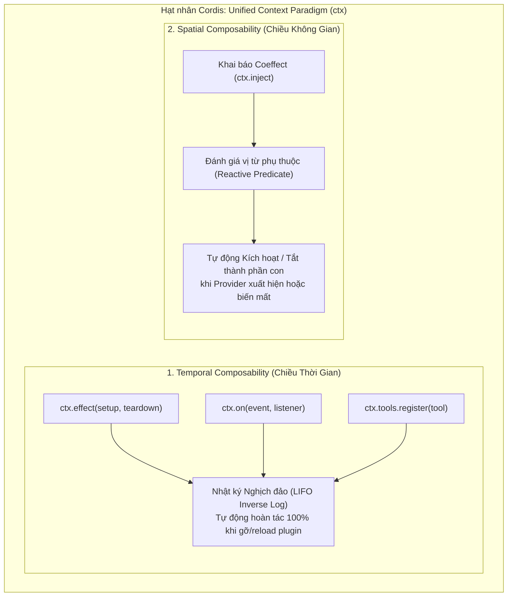
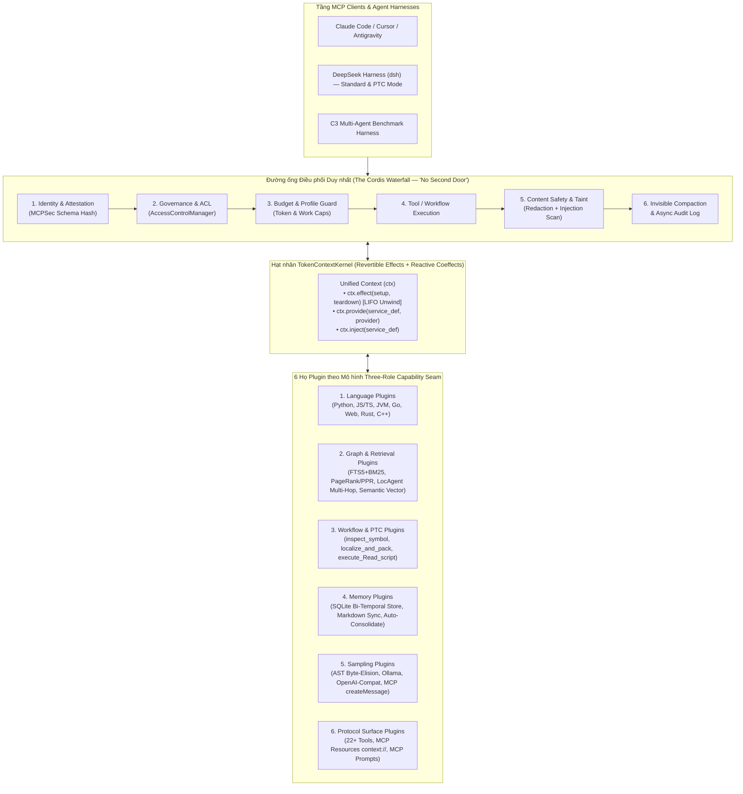

# BÁO CÁO NGHIÊN CỨU CHUYÊN SÂU: HỆ SINH THÁI MCP, KIẾN TRÚC DEEPSEEK HARNESS ("EVERYTHING IS A PLUGIN") & BẢN THIẾT KẾ NÂNG CẤP `token-context-mcp`
# DEEP RESEARCH REPORT: THE MCP ECOSYSTEM, DEEPSEEK HARNESS ("EVERYTHING IS A PLUGIN") & ARCHITECTURAL BLUEPRINT FOR `token-context-mcp`

> **Ngày thực hiện / Date:** 2026-10-20  
> **Đối tượng nghiên cứu / Target Repository:** [`D:\AI\token-context-mcp`](file:///D:/AI/token-context-mcp) (v0.3.3 $\rightarrow$ v0.4.0 / v1.0 Architecture)  
> **Ngôn ngữ / Language:** Song ngữ Việt - Anh (Bilingual Vietnamese – English)  
> **Tài liệu học thuật & Công nghiệp cốt lõi / Core Papers & Repos:**  
> - **DeepSeek Harness (`dsh`) & Cordis:** [`deepseek-ai/deepseek-harness`](https://github.com/deepseek-ai/deepseek-harness) & *A Programming Paradigm for Spatiotemporal Composability* (Shi, Zhang, Cui — Peking University & DeepSeek-AI, **arXiv:2608.25512**)  
> - **Code Graph & Agentic Localization:** *RepoGraph* (**ICLR 2025**, `arXiv:2410.14684`), *LocAgent* (**ACL 2025**, `arXiv:2503.09089`), *CodexGraph* (**NAACL 2025**, `arXiv:2408.03910`), *Agentless* (`arXiv:2407.01489`), *SWE-agent ACI* (**NeurIPS 2024**, `arXiv:2405.15793`)  
> - **MCP Security & Protocol Analysis:** *MCPInspect* (**DSN 2026**, `arXiv:2510.16558`), *Breaking the Protocol / MCPBench & MCPSec* (`arXiv:2601.17549`), *MCP at First Glance* (`arXiv:2506.13538`)

---

## MỤC LỤC / TABLE OF CONTENTS

- **[PHẦN 1: BÁO CÁO NGHIÊN CỨU & THIẾT KẾ KIẾN TRÚC (BẢN TIẾNG VIỆT)](#phần-1-báo-cáo-nghiên-cứu--thiết-kế-kiến-trúc-bản-tiếng-việt)**
  - [Chương 1: Giải mã DeepSeek Harness (`dsh`), Cordis & Triết lý *"Everything is a Plugin"*](#chương-1-giải-mã-deepseek-harness-dsh-cordis--triết-lý-everything-is-a-plugin)
  - [Chương 2: Khảo sát Hệ sinh thái MCP Server phổ biến nhất trên GitHub (2025–2026)](#chương-2-khảo-sát-hệ-sinh-thái-mcp-server-phổ-biến-nhất-trên-github-20252026)
  - [Chương 3: Tổng hợp các Bài báo Học thuật & Công nghiệp (2024–2026)](#chương-3-tổng-hợp-các-bài-báo-học-thuật--công-nghiệp-20242026)
  - [Chương 4: Kiểm toán Kiến trúc `token-context-mcp` (v0.3.3) — Điểm mạnh & 6 Điểm nghẽn Monolithic](#chương-4-kiểm-toán-kiến-trúc-token-context-mcp-v033--điểm-mạnh--6-điểm-nghẽn-monolithic)
  - [Chương 5: Bản thiết kế Nâng cấp `token-context-mcp` theo kiến trúc *"Everything is a Plugin"*](#chương-5-bản-thiết-kế-nâng-cấp-token-context-mcp-theo-kiến-trúc-everything-is-a-plugin)
  - [Chương 6: Lộ trình Triển khai Thực thi (Roadmap M14 $\rightarrow$ M17)](#chương-6-lộ-trình-triển-khai-thực-thi-roadmap-m14--m17)
- **[PART 2: DEEP RESEARCH & ARCHITECTURAL BLUEPRINT (ENGLISH VERSION)](#part-2-deep-research--architectural-blueprint-english-version)**
  - [Chapter 1: Deconstructing DeepSeek Harness (`dsh`), Cordis & *"Everything is a Plugin"*](#chapter-1-deconstructing-deepseek-harness-dsh-cordis--everything-is-a-plugin)
  - [Chapter 2: Production MCP Ecosystem Survey on GitHub (2025–2026)](#chapter-2-production-mcp-ecosystem-survey-on-github-20252026)
  - [Chapter 3: Academic & Industrial Literature Review (2024–2026)](#chapter-3-academic--industrial-literature-review-20242026)
  - [Chapter 4: Architectural Audit of `token-context-mcp` (v0.3.3) — Strengths & 6 Monolithic Bottlenecks](#chapter-4-architectural-audit-of-token-context-mcp-v033--strengths--6-monolithic-bottlenecks)
  - [Chapter 5: Next-Gen Blueprint — Transforming `token-context-mcp` with *"Everything is a Plugin"*](#chapter-5-next-gen-blueprint--transforming-token-context-mcp-with-everything-is-a-plugin)
  - [Chapter 6: Phased Implementation Roadmap (M14 $\rightarrow$ M17)](#chapter-6-phased-implementation-roadmap-m14--m17)

---

# PHẦN 1: BÁO CÁO NGHIÊN CỨU & THIẾT KẾ KIẾN TRÚC (BẢN TIẾNG VIỆT)

---

## Chương 1: Giải mã DeepSeek Harness (`dsh`), Cordis & Triết lý *"Everything is a Plugin"*

### 1.1 Nguồn gốc khẩu hiệu *"Everything is a Plugin"* và *"Agent = Model + Harness"*
Khẩu hiệu **"Everything is a Plugin"** (Mọi thứ đều là một Plugin) và phương trình kiến trúc **"Agent = Model + Harness"** là triết lý cốt lõi của **[`deepseek-ai/deepseek-harness`](https://github.com/deepseek-ai/deepseek-harness)** (viết tắt là `dsh`, chạy qua gói `@deepseek-ai/dsh`) — bộ khung thực thi (agent runtime & harness) mã nguồn mở chính thức của **DeepSeek AI**.

Nền tảng toán học và khoa học máy tính đứng sau `deepseek-harness` được công bố trong bài báo nghiên cứu của Đại học Bắc Kinh (Peking University) và DeepSeek-AI:
* **Tên bài báo:** *"A Programming Paradigm for Spatiotemporal Composability"*
* **Tác giả:** Yifan Shi (Peking University & DeepSeek-AI), Wei Zhang (Peking University), Tianyi Cui (DeepSeek-AI)
* **Mã định danh:** **arXiv:2608.25512**
* **Meta-framework lõi:** **Cordis** (hạt nhân điều phối tính hợp thành không-thời gian).

### 1.2 Hai chiều kích của Tính hợp thành Không-Thời gian (Spatiotemporal Composability)
Các hệ thống plugin truyền thống (như VS Code extensions, Webpack, hay các framework agent đời đầu) thường mắc phải căn bệnh **"rò rỉ trạng thái" (state leakage)**: khi một plugin được nạp, gỡ bỏ hoặc thay thế nóng (hot-swap) lúc đang chạy, các event listeners, công cụ đã đăng ký, biến toàn cục hoặc kết nối cơ sở dữ liệu bị bỏ sót lại, gây hỏng trạng thái hoặc buộc phải khởi động lại toàn bộ tiến trình.

Bài báo **arXiv:2608.25512** và framework **Cordis** giải quyết triệt để bài toán này bằng cách nâng hai khái niệm của lập trình hàm (**Effects** và **Coeffects**) thành cơ chế runtime dọc theo hai trục trực giao:



1. **Tính hợp thành theo Thời gian — Temporal Composability (Revertible Effects / Hiệu ứng khả nghịch):**
   * Mỗi khi một plugin tác động lên môi trường (đăng ký một MCP tool, gắn một hook listener, mở một file watcher, biến đổi context), runtime bắt buộc gắn kèm một **phép toán nghịch đảo (inverse operation)** vào nhật ký hiệu ứng của riêng component đó.
   * Khi plugin bị gỡ bỏ, tắt quyền hoặc cập nhật cấu hình (hot-reload), Cordis tự động tua ngược (unwind) các hiệu ứng theo thứ tự **LIFO (Vào sau - Ra trước)**, đảm bảo môi trường trở về trạng thái sạch tuyệt đối như thể plugin đó chưa từng tồn tại.
2. **Tính hợp thành theo Không gian — Spatial Composability (Reactive Coeffects / Đồng hiệu ứng phản ứng):**
   * Thay vì các module tự đi tìm hoặc kiểm tra vòng lặp (polling) xem dịch vụ mình cần đã khởi tạo chưa, mỗi plugin khai báo **Coeffect specification** (những dịch vụ/cấu hình mà nó *đòi hỏi* từ môi trường, ví dụ: cần `sandbox`, cần `sqlite_store`, cần `ollama`).
   * Khi một dịch vụ hạ tầng thay đổi (ví dụ: người dùng bật/tắt `enable_extensions`, hoặc Ollama cục bộ vừa bật lên), Cordis tự động kích hoạt (activate) hoặc đóng băng (deactivate) các plugin phụ thuộc theo thời gian thực.
3. **Định lý Tương đương Quan sát (Observational Equivalence Metatheorem):**
   * Hợp nhất Effect Context và Coeffect Context vào một kiểu dữ liệu duy nhất là `Context` (`ctx`). Bài báo chứng minh rằng một hệ thống trải qua hàng trăm lần nạp/gỡ/nâng cấp plugin động lúc chạy sẽ có trạng thái **tương đương tuyệt đối** với hệ thống được khởi tạo tĩnh ngay từ đầu với tập plugin đang bật.

### 1.3 Kiến trúc "Three-Role Capability Seam" (Đường nối Năng lực 3 Vai trò)
Trong `deepseek-harness`, không có bất kỳ tính năng nào (kể cả vòng lặp agent, bộ nhớ, shell, hay giao diện web) được viết cứng. Mọi năng lực đều phải chia thành **3 vai trò tách biệt hoàn toàn**:

| Vai trò (Role) | Trách nhiệm kỹ thuật | Ví dụ trong `deepseek-harness` | Ánh xạ tương đương cho `token-context-mcp` |
| :--- | :--- | :--- | :--- |
| **1. Service Definition** *(Định nghĩa dịch vụ)* | Chỉ khai báo hợp đồng giao diện trừu tượng (Abstract Contract) và kiểu dữ liệu trên `ctx`. Không chứa logic thực thi. | `ctx.sandbox`, `ctx.compaction`, `ctx.shell`, `ctx.subagents` | `ctx.language_registry`, `ctx.index_store`, `ctx.memory`, `ctx.sampling`, `ctx.governance` |
| **2. Service Provider** *(Nhà cung cấp dịch vụ)* | Plugin cụ thể cài đặt hợp đồng đó cho một môi trường nhất định. Có thể hoán đổi nóng mà không ảnh hưởng tầng trên. | `sandbox-bwrap`, `sandbox-landlock`, `sandbox-seatbelt`, `ssh-remote` | `SqliteIndexProvider`, `OllamaSamplingProvider`, `McpClientSamplingProvider`, `JvmLanguageProvider` |
| **3. Consumer** *(Tầng tiêu thụ)* | Các MCP tools, Agent workflows hoặc giao diện người dùng gọi dịch vụ thông qua `ctx`. | `tool-bash`, `ptc-runtime`, `web-app` | 22 MCP Tools (`inspect_symbol`, `search_source`, `memory_put`, `sample_summarize`) & PySide6 GUI |

### 1.4 Năm Cơ chế Đột phá của `deepseek-harness`

1. **Đường ống Điều phối Duy nhất — The Cordis Waterfall ("No Second Door"):**
   Mọi lời gọi công cụ (dù là tool nội bộ, MCP tool bên ngoài, hay script trong PTC) đều bắt buộc đi qua một thác nước middleware duy nhất:
   $$\texttt{tool/call} \longrightarrow \texttt{tools/pre-execute} \longrightarrow \texttt{tools/execute} \longrightarrow \texttt{tools/post-execute} \longrightarrow \texttt{tool/result}$$
   Không có bất kỳ "cửa hậu" nào. Các plugin kiểm soát quyền (`permission-presets`), kiểm tra bảo mật, chống tràn token và ghi nhật ký (`audit`) chỉ cần gắn hook vào `tools/pre-execute` và `tools/post-execute` là bao phủ 100% hệ thống.

2. **Nén Ngữ cảnh Vô hình — Compaction as an Invisible Seam (`packages/compaction/`):**
   * Khác với các hệ thống bắt LLM phải tự nhớ gọi tool nén, trong `deepseek-harness`, `ctx.compaction` là một đường nối vô hình (invisible seam) tự kích hoạt khi áp lực token vượt ngưỡng.
   * **Bảo toàn Nhật ký Chỉ-Ghi-Thêm (Append-Only Log Preservation):** Compaction không bao giờ xóa lịch sử gốc trên đĩa. Nó ghi các sự kiện `compaction/start`, `compaction/summary`, `compaction/end` và thực hiện phép thế cấu trúc (`surfaceOp: { op: 'replace', ... }`) trên bề mặt tin nhắn gửi cho model.

3. **Programmatic Tool Calling — PTC (`packages/ptc-runtime/` & `packages/typert/`):**
   * Thay vì để LLM gọi tuần tự 10 lượt tool (tốn 10 vòng lặp mạng + suy luận), ở chế độ `PTC`, `deepseek-harness` dùng `typert` tự động sinh ra một **TypeScript SDK có kiểu tĩnh** từ toàn bộ các tool đang đăng ký (bao gồm cả các MCP tools có dạng `mcp__<serverName>__<rawName>`).
   * LLM chỉ cần viết một đoạn code TypeScript bất đồng bộ duy nhất gọi `run_code` để lặp, lọc, gọi song song (`Promise.all`) các công cụ trong một worker thread cô lập và chỉ trả kết quả tinh gọn cuối cùng về cửa sổ ngữ cảnh.

4. **Bốn Chế độ Agent Presets (`apps/cli/config/agent-presets/`):**
   * `standard/` (**Standard**): Đầy đủ công cụ điều hướng, chỉnh sửa, shell, subagent.
   * `code/` (**PTC**): Chế độ lập trình công cụ qua `run_code` + TypeScript SDK.
   * `minimal/` (**Minimal**): Tối giản chỉ gồm `bash` và `str_replace_editor` phục vụ đánh giá benchmark công bằng (như DeepSeek-V4-Flash).
   * `cordis/` (**Creator**): Cho phép chính Agent tự kiểm tra cấu trúc runtime và viết mới/cập nhật plugin ngay trong phiên chạy.

5. **Thác quyền hạn Đóng-An-Toàn — Fail-Closed Permission & Sandbox Waterfall:**
   * Chuỗi kiểm duyệt `ctx.approval` (`allow` / `ask` / `deny`) $\rightarrow$ `ctx.permissionPresets` (`read-only`, `workspace-write`, `danger-full-access`) $\rightarrow$ `ctx.sandbox` (Bubblewrap / Landlock / Seatbelt). Nếu yêu cầu chạy sandbox mà OS không hỗ trợ, hệ thống lập tức hủy lệnh (`SANDBOX_UNAVAILABLE`) chứ không bao giờ âm thầm chạy không bảo vệ.

---

## Chương 2: Khảo sát Hệ sinh thái MCP Server phổ biến nhất trên GitHub (2025–2026)

Để biết `token-context-mcp` đang đứng ở đâu và cần học hỏi gì từ thị trường, dưới đây là bảng phân tích chuyên sâu 12 dự án MCP hàng đầu trên GitHub hiện nay chia theo 3 nhóm chức năng:

### 2.1 Bảng Đối sánh Kiến trúc Toàn diện (Master Comparison Matrix)

| Dự án / Repository | Nhóm chức năng | Engine Lưu trữ | Chiến lược Phân tích Cú pháp (AST / LSP / Vector) | Cơ chế Tiết kiệm Token & Hiệu năng Thực tế | Điểm mạnh & Điểm yếu so với `token-context-mcp` |
| :--- | :--- | :--- | :--- | :--- | :--- |
| **[`DeusData/codebase-memory-mcp`](https://github.com/DeusData/codebase-memory-mcp)** | Code Graph & Đồ thị Tri thức | **SQLite** (Đồ thị cục bộ kèm lớp truy vấn kiểu Cypher) | **Tree-sitter** (162 ngôn ngữ) + **Hybrid LSP** giải kiểu; đóng gói 1 file binary tĩnh duy nhất | Giảm tới **~120 lần** lượng token trên các truy vấn cấu trúc liên file; index Linux kernel (28M dòng) trong ~3 phút | **Mạnh:** Hỗ trợ 162 ngôn ngữ, hỗ trợ truy vấn đồ thị kiểu Cypher (`query_graph`), phát hiện HTTP routes.<br>**Yếu:** Thiếu lớp quản trị quyền đa Agent (Governance/ACL) và bộ nhớ phiên làm việc như `token-context-mcp`. |
| **[`oraios/serena`](https://github.com/oraios/serena)** | Định vị & Refactoring mức Symbol | In-memory + Markdown (`.serena/memories`) | Điều khiển trực tiếp **Language Server Protocol (LSP)** (40+ ngôn ngữ) + **JetBrains IDE Bridge** | Tiết kiệm 70–90% token khi sửa file lớn nhờ đọc/ghi theo đơn vị hàm (`replace_symbol_body`, `insert_after_symbol`) | **Mạnh:** Độ chính xác giải kiểu tuyệt đối của trình biên dịch thật (generics, overloads) và công cụ sửa code theo symbol.<br>**Yếu:** Khởi động LSP nặng RAM/CPU; phơi bày ~30 tools gây "Nghịch lý đa công cụ" (Multi-Tool Paradox) làm tốn token chọn tool. |
| **[`zilliztech/claude-context`](https://github.com/zilliztech/claude-context)** | Tìm kiếm Ngữ nghĩa (Semantic Code Search) | **Milvus / Zilliz Cloud** (hoặc Milvus Lite cục bộ) | **Tree-sitter** cắt khúc AST + **Hybrid Search (BM25 + Dense Vector)** + **Merkle Tree** đồng bộ增量 (incremental sync) | Giảm **~62% token** trên các truy vấn tìm kiếm khái niệm/hành vi ("xử lý retry backoff ở đâu?") | **Mạnh:** Giải quyết cực tốt truy vấn hành vi không biết tên hàm (điểm yếu `b_hidden_dep` hiện tại của `token-context-mcp`); Merkle Tree sync rất nhanh.<br>**Yếu:** Phụ thuộc модель embedding và cơ sở dữ liệu vector; không có đồ thị caller/callee. |
| **[`yamadashy/repomix`](https://github.com/yamadashy/repomix)** | Đóng gói & Nén Khung toàn Repo | Stateless / Xuất file XML, Markdown, JSON | **Tree-sitter** (`--compress` chỉ giữ chữ ký hàm/class, bỏ thân hàm) + **Secretlint** lọc khóa bí mật | Chế độ `--compress` giảm **~70–80% token** của toàn bộ repository trong 1 lượt gọi | **Mạnh:** Tích hợp Secretlint bảo mật và trích xuất khung toàn bộ repo cực nhanh.<br>**Yếu:** Không có tìm kiếm đồ thị sâu hay phân tích phạm vi ảnh hưởng (impact slice). |
| **[`upstash/context7`](https://github.com/upstash/context7)** | Chống ảo giác Tài liệu Thư viện | Upstash Vector + Redis Cloud | Phân tích tài liệu chính thức gắn chặt theo từng phiên bản thư viện (`resolve-library-id`, `get-library-docs`) | Loại bỏ hoàn toàn vòng lặp tìm kiếm web sai lệch khi dùng thư viện bên ngoài | **Mạnh:** Chuẩn mực công nghiệp cho việc tra cứu API bên ngoài.<br>**Gợi ý:** `token-context-mcp` có thể nâng cấp `stubs/catalog.py` để liên kết động với tài liệu kiểu Context7. |
| **[`johnhuang316/code-index-mcp`](https://github.com/johnhuang316/code-index-mcp)** | Chỉ mục Code Gọn nhẹ | File index cục bộ (`.indexes/`) + Vector tùy chọn | **Tree-sitter** (48 ngôn ngữ) + File Watcher thời gian thực + Reranking | Tra cứu dưới 100ms; giảm 50–75% token so với grep đệ quy | **Mạnh:** Tự động theo dõi file thay đổi (auto-watch) mượt mà.<br>**Yếu:** Đồ thị phụ thuộc nông hơn nhiều so với `token-context-mcp`. |
| **[`jlowin/fastmcp`](https://github.com/jlowin/fastmcp)** (v2) | Framework & Gateway MCP | Đa năng (Framework) | Kiến trúc **Provider v2** (`LocalProvider`, `FastMCPProvider`, `ProxyProvider`) + `gateway.mount()` | Hỗ trợ gắn kết (mount) các plugin server theo namespace và lọc công cụ động | **Mạnh:** Kiến trúc `Provider` v2 của FastMCP rất gần với triết lý Plugin của Cordis, rất đáng học hỏi để tái cấu trúc `server.py`. |
| **[`topoteretes/cognee`](https://github.com/topoteretes/cognee)** | Bộ nhớ Đồ thị + Vector Đa tầng | **Kuzu** (Graph nhúng) + **LanceDB** (Vector) + **SQLite** | Trích xuất thực thể bằng LLM hoặc mô hình cục bộ **GLiNER** + Tree-sitter (`codify`) + 14 chế độ tìm kiếm | Giảm 60–80% nhiễu RAG nhờ kết hợp duyệt đồ thị Kuzu với tìm kiếm vector LanceDB | **Mạnh:** Kiến trúc 3 kho nhúng (SQLite + LanceDB + Kuzu) hoàn toàn không cần cài đặt server DB rời.<br>**Yếu:** Quá trình `cognify` ban đầu tốn thời gian gọi LLM. |
| **[`getzep/graphiti`](https://github.com/getzep/graphiti)** | Đồ thị Tri thức Thời gian kép (Bi-Temporal) | **Neo4j** hoặc **FalkorDB** | **Mô hình Thời gian kép** ($t_{\text{valid}}$ vs. $t_{\text{transaction}}$) + Giải thực thể xác định bằng **MinHash / LSH / Jaccard** | Giảm tới **90% token** lịch sử hội thoại; độ trễ P95 < 200ms; tự động vô hiệu hóa cạnh cũ khi kiến trúc thay đổi | **Mạnh:** Cơ chế đánh dấu thời gian hiệu lực của kiến thức (khi code đổi, kết luận cũ tự động hết hiệu lực mà không mất lịch sử) và gom nhóm bằng MinHash không tốn LLM. |
| **[`mem0ai/mem0-mcp`](https://github.com/mem0ai/mem0-mcp)** | Bộ nhớ Thích ứng cho Agent | Qdrant / Milvus / Chroma + Đồ thị tùy chọn | Trích xuất sự kiện và tự động giải quyết xung đột (`ADD`, `UPDATE`, `DELETE`, `NOOP`) | Giảm **~90% token** so với truyền lịch sử chat; tăng 26% độ chính xác trên benchmark LOCOMO | **Mạnh:** Cơ chế tự động phát hiện mâu thuẫn (`UPDATE`/`DELETE`) khi ghi nhớ mới phủ định ghi nhớ cũ. |
| **[`basicmachines-co/basic-memory`](https://github.com/basicmachines-co/basic-memory)** | Bộ nhớ Markdown Đồng bộ 2 chiều | **File Markdown** (`.md`) đồng bộ 2 chiều với **SQLite FTS5** | Mỗi ghi chú gồm YAML frontmatter, `observations`, `relations` (WikiLinks) truy cập qua URI `memory://` | Nạp đúng nhánh kiến thức qua URI `memory://` cực kỳ tiết kiệm token | **Mạnh:** Con người có thể đọc/sửa trực tiếp file `.md` bằng Git/Obsidian và tự động đồng bộ vào SQLite của MCP. |
| **[`metatool-ai/metamcp`](https://github.com/metatool-ai/metamcp) & Cloudflare Code Mode** | Khám phá Công cụ & Thực thi Code | SQLite/Postgres + V8 Isolates Sandbox | Thu gọn hàng nghìn MCP tools thành 2 công cụ duy nhất: `search_tools` + `execute_code` (sinh TypeScript SDK) | **Giảm >98% token schema công cụ** (nén 2.500 API từ >200.000 tokens xuống **~1.000 tokens**) | **Mạnh:** Tương đồng trực tiếp với chế độ **PTC** của `deepseek-harness` và bộ `discovery/` của `token-context-mcp`. |

---

## Chương 3: Tổng hợp các Bài báo Học thuật & Công nghiệp (2024–2026)

### 3.1 Nhóm bài báo về Đồ thị Mã nguồn & Định vị Lỗi (Code Graph & Localization)

1. **RepoGraph (*ICLR 2025*, `arXiv:2410.14684` — Ouyang et al.):**
   * **Đóng góp cốt lõi:** Xây dựng đồ thị mã nguồn ở **2 độ mịn**: mức định nghĩa (`function`, `class`, `module`) và **mức dòng lệnh (line-level statement nodes)** với 2 loại cạnh `contain` (bao hàm) và `invoke` (gọi/tham chiếu).
   * **Bài học cho `token-context-mcp`:** Hiện tại `token-context-mcp` mới dừng ở mức symbol-level (`SymbolRecord`). Khi một hàm dài 300 dòng, việc lưu thêm các nút tham chiếu mức dòng hoặc khối điều kiện (statement-level anchors) trong `inspect_symbol` sẽ giúp tăng độ chính xác định vị sửa lỗi thêm **+8.56% tương đối** (như thực nghiệm của RepoGraph trên SWE-bench Lite).

2. **LocAgent (*ACL 2025*, `arXiv:2503.09089` — Chen et al.):**
   * **Đóng góp cốt lõi:** Biểu diễn toàn bộ repo thành **Đồ thị Dị thể Có hướng (Directed Heterogeneous Graph)** gồm 4 loại đỉnh (`Directory`, `File`, `Class`, `Function`) và 4 loại cạnh (`contain`, `import`, `invoke`, `inherit`). Chỉ cung cấp đúng 3 công cụ nguyên tử cho Agent: `SearchEntity` (tìm kiếm thưa theo từ khóa/ID), `TraverseGraph` (duyệt đa bước có lọc theo kiểu đỉnh và kiểu cạnh), và `RetrieveEntity` (đọc mã nguồn thực).
   * **Số liệu thực nghiệm:** Đạt **92.7% File Acc@5** trên SWE-bench Lite với mô hình mã nguồn mở Qwen-2.5-Coder-32B, giảm **86% chi phí suy luận**.
   * **Bài học cho `token-context-mcp`:** Hiện tại `get_impact_slice` của `token-context-mcp` chỉ duyệt cạnh `calls` (`direction="callers"|"callees"`), chưa cho phép Agent truyền bộ lọc duyệt đồng thời qua các loại cạnh `inheritance` (kế thừa), `imports` (nhập module), và `containment` (thư mục/file/class) trong cùng một truy vấn `TraverseGraph` như LocAgent!

3. **Agentless (`arXiv:2407.01489` — Xia et al., UIUC) & SWE-agent ACI (*NeurIPS 2024*, `arXiv:2405.15793` — Yang et al., Princeton):**
   * **Đóng góp cốt lõi:**
     - *Agentless* chứng minh quy trình phân cấp xác định: **Cây thư mục + Embedding $\rightarrow$ Khung AST Skeleton (chỉ chữ ký) $\rightarrow$ Khoanh vùng dòng code** giúp đạt hiệu quả sửa lỗi cao với chi phí chỉ \$0.34–\$0.70/issue.
     - *SWE-agent ACI (Agent-Computer Interface)* chứng minh rằng việc giới hạn kết quả tìm kiếm (tối đa 50 dòng), đọc code theo cửa sổ (windowed viewer 100 dòng kèm số dòng), và gập lịch sử cũ (history folding) giúp tăng hiệu năng của cùng một LLM lên **3.3 lần**.
   * **Bài học cho `token-context-mcp`:** `token-context-mcp` đã áp dụng rất tốt nguyên lý ACI (như `get_file_skeleton`, `body_offset_line` windowed read trong v0.3.3, và ngân sách token cố định trong `packet.py`). Bước tiếp theo là đóng gói quy trình 3 bước của *Agentless* thành một **Composite Workflow Plugin** (`localize_and_pack`).

### 3.2 Nhóm bài báo về Bảo mật & Giao thức MCP (MCP Security & Protocol Verification)

1. **MCP Ecosystem Security & `MCPInspect` (*IEEE/IFIP DSN 2026*, `arXiv:2510.16558` — Li & Gao):**
   * Khảo sát hơn **67.000 MCP servers** trên các chợ công cộng, phát hiện **833 servers có lỗ hổng khai thác mã nguồn** và **18 servers cài cắm mô tả độc hại (Tool Poisoning)**.
   * Đề xuất công cụ **`MCPInspect`** kiểm tra sự bất nhất ngữ nghĩa (Semantic Inconsistency) giữa chuỗi mô tả của tool và cây AST thực thi thực tế của hàm đó.

2. **Breaking the Protocol: `MCPBench` & `MCPSec` (`arXiv:2601.17549` — Maloyan & Namiot, 2026):**
   * Chỉ ra **3 lỗ hổng thiết kế cốt lõi của chuẩn MCP**:
     1. *Thiếu Chứng thực Năng lực (Lack of Capability Attestation):* Tool schema có thể bị thay đổi ngầm lúc chạy ("rug-pull").
     2. *Lấy mẫu Hai chiều Không xác thực (Unauthenticated Bidirectional Sampling `sampling/createMessage`):* Server bị nhiễm độc có thể gửi ngược prompt độc hại về LLM của Client.
     3. *Lan truyền Tin cậy Ngầm định (Implicit Trust Propagation):* Dữ liệu chưa làm sạch từ tool đọc ngoài đi thẳng vào ngữ cảnh chung để kích hoạt các tool có quyền ghi cao.
   * Trên 847 kịch bản tấn công của `MCPBench`, chuẩn MCP mặc định làm **tăng tỷ lệ tấn công thành công (ASR) thêm từ +23% đến +41%**. Bản mở rộng **`MCPSec` (`AttestMCP`)** bổ sung chữ ký schema, đánh dấu nguồn gốc dữ liệu (taint tracking) và cổng kiểm duyệt sampling, giúp **giảm >85% ASR** với độ trễ **< 5ms**.

3. **MCP at First Glance (`arXiv:2506.13538` — Hassan et al.):**
   * Phân tích thực nghiệm **1.899 MCP servers** mã nguồn mở: **7.2%** dính lỗi bảo mật cổ điển (Command Injection, Path Traversal), **5.5%** dính lỗi Tool Poisoning (nối chuỗi dữ liệu ngoài trực tiếp vào MCP Prompt/Description), và **66.0%** có mùi mã nguồn bảo trì kém (code smells) do viết nguyên khối (monolithic).

---

## Chương 4: Kiểm toán Kiến trúc `token-context-mcp` (v0.3.3) — Điểm mạnh & 6 Điểm nghẽn Monolithic

Qua phân tích toàn bộ mã nguồn tại [`D:\AI\token-context-mcp`](file:///D:/AI/token-context-mcp), chúng ta thấy rõ bức tranh kỹ thuật hiện tại:

### 4.1 Những điểm `token-context-mcp` đang dẫn đầu xu thế
1. **Kiến trúc Zero-Daemon SQLite + FTS5 + Tree-sitter:** Hoàn toàn cục bộ, có cơ chế swap snapshot nguyên tử (`active_snapshot.json`) và giải cạnh增量 (incremental edge resolution khi $\le 25\%$ file thay đổi tại [`index/runner.py:1115-1221`](file:///D:/AI/token-context-mcp/src/token_context_mcp/index/runner.py#L1115-L1221)).
2. **Xếp hạng Đồ thị Toàn cục & Cá nhân hóa (PageRank / PPR):** Kết hợp Andersen-Chung-Lang `local_push_ppr` với trọng số vai trò cấu trúc (`retrieve/ranking.py`).
3. **Đóng gói Ngữ cảnh Đảm bảo Ngân sách Tuyệt đối (`retrieve/packet.py`):** Phân bổ tỷ lệ 2 pha (`0.30 / 0.25 / 0.25 / 0.08 / 0.12`) kèm vòng lặp cắt tỉa điểm bất động (`trim_packet`), đảm bảo không bao giờ tràn ngân sách token.
4. **Hệ thống Quản trị & Bảo mật Đa Agent (`security/`):** Có sẵn `AccessControlManager` (<0.02ms), `GovernanceStore`, `AuditLogger` bất đồng bộ, khóa danh tính `TOKEN_CONTEXT_AGENT_ID`, và quét prompt injection (`content_policy.py`).

### 4.2 Sáu Điểm nghẽn Nguyên khối (Monolithic Bottlenecks) cần phá bỏ

| STT | Điểm nghẽn Kiến trúc | Vị trí chính xác trong Mã nguồn (`file:line`) | Hệ quả Kỹ thuật |
| :---: | :--- | :--- | :--- |
| **1** | **Hỗ trợ ngôn ngữ bị phân mảnh qua 7+ file cứng** | • [`constants.py:11-25`](file:///D:/AI/token-context-mcp/src/token_context_mcp/constants.py#L11-L25) (`SUPPORTED_EXTENSIONS`)<br>• [`parse/treesitter.py:74-138, 246-265, 1933-2344`](file:///D:/AI/token-context-mcp/src/token_context_mcp/parse/treesitter.py#L74-L138)<br>• [`parse/lexical_edges.py:966-1525`](file:///D:/AI/token-context-mcp/src/token_context_mcp/parse/lexical_edges.py#L966-L1525)<br>• [`index/runner.py:463-483, 1259-1393`](file:///D:/AI/token-context-mcp/src/token_context_mcp/index/runner.py#L463-L483)<br>• [`stubs/catalog.py:5-75`](file:///D:/AI/token-context-mcp/src/token_context_mcp/stubs/catalog.py#L5-L75) | Muốn thêm 1 ngôn ngữ mới (như Rust, C++, Kotlin, SQL) phải sửa ít nhất 7 file lõi. Ngoài ra `_declared_entry_points` (`runner.py:1259`) và `CURATED_EXTERNAL_STUBS` (`stubs/catalog.py`) hiện **chỉ hỗ trợ Python** (`pyproject.toml`), bỏ qua `package.json`, `go.mod`, `pom.xml`, `.csproj`. |
| **2** | **Đăng ký 22 MCP Tools bằng hàm lồng nhau dài 500 dòng & 3 nơi khai báo rời rạc** | • [`server.py:211-707`](file:///D:/AI/token-context-mcp/src/token_context_mcp/server.py#L211-L707) (22 nested `@server.tool`)<br>• [`discovery/catalog.py:21-293`](file:///D:/AI/token-context-mcp/src/token_context_mcp/discovery/catalog.py#L21-L293) (`TOOL_CATALOG`)<br>• [`security/access_control.py:79-102`](file:///D:/AI/token-context-mcp/src/token_context_mcp/security/access_control.py#L79-L102) (`READ_ONLY_TOOLS` / `WRITE_OR_MUTATING_TOOLS`) | Mỗi khi thêm/sửa 1 tool phải cập nhật thủ công ở 3 file khác nhau. Thực tế hiện tại 3 tool (`memory_consolidate`, `agent_control`, `audit_logs`) **đang bị thiếu** trong cả 2 tập `READ_ONLY_TOOLS` và `WRITE_OR_MUTATING_TOOLS` ở `access_control.py`! |
| **3** | **Hàm điều phối `_dispatch_invoke` viết cứng (Procedural)** | • [`server.py:726-808`](file:///D:/AI/token-context-mcp/src/token_context_mcp/server.py#L726-L808) | Gom chung xác thực identity, ACL, thực thi, audit log và сериализация vào 1 hàm duy nhất. Không thể gắn thêm middleware (như Capability Attestation, Taint Tracking, hay Auto-Compaction) một cách độc lập. |
| **4** | **Hàm `save_config` tự nối chuỗi TOML thủ công làm mất cấu hình mở rộng** | • [`config.py:124-174`](file:///D:/AI/token-context-mcp/src/token_context_mcp/config.py#L124-L174) | `save_config` ghi đè file `repos.toml` bằng cách ghép từng dòng chuỗi cho `[server]` và `[repos]`. Mọi cấu hình `[plugins]` hoặc `[harness]` người dùng thêm vào sẽ bị xóa sạch khi chạy `register` hoặc lưu từ GUI! |
| **5** | **`SamplingRouter` chỉ hỗ trợ Ollama & `skeleton_hybrid.py` dùng Regex thiên vị Python/JS** | • [`sampling/router.py:25-247`](file:///D:/AI/token-context-mcp/src/token_context_mcp/sampling/router.py#L25-L247)<br>• [`sampling/skeleton_hybrid.py:89-108`](file:///D:/AI/token-context-mcp/src/token_context_mcp/sampling/skeleton_hybrid.py#L89-L108) | `skeleton_hybrid.py:90` dùng regex `r"\s*(?:async\s+def|def|function)\s+"` và đếm khoảng trắng thụt lề để cắt thân hàm — **không hoạt động với Java, C#, Go, TypeScript class methods** (dù Tree-sitter đã có sẵn `body_start_byte` và `body_end_byte`!). |
| **6** | **Các khoảng trống Độ chính xác từ Benchmark M13 & Backlog E14** | • [`docs/BENCHMARK.md:434-443, 500-529`](file:///D:/AI/token-context-mcp/docs/BENCHMARK.md#L434-L443)<br>• [`docs/BACKLOG.md:5-8`](file:///D:/AI/token-context-mcp/docs/BACKLOG.md#L5-L8)<br>• [`retrieve/workflows.py:20-329`](file:///D:/AI/token-context-mcp/src/token_context_mcp/retrieve/workflows.py#L20-L329) | • TypeScript (`zod`) còn 56% cạnh mơ hồ do chưa giải re-export/type alias.<br>• Truy vấn hành vi không nêu tên hàm (`b_hidden_dep`) đạt điểm thấp (0.10–0.40).<br>• Lỗi E14: `inspect_symbol` ở chế độ `minimal` và `normal` lọc cạnh chưa khớp hợp đồng thiết kế. |

---

## Chương 5: Bản thiết kế Nâng cấp `token-context-mcp` theo kiến trúc *"Everything is a Plugin"*

Dựa trên bài báo **Cordis / DeepSeek Harness (`arXiv:2608.25512`)**, các nghiên cứu **LocAgent (`ACL 2025`)**, **RepoGraph (`ICLR 2025`)**, và **MCPSec (`arXiv:2601.17549`)**, chúng ta thiết kế kiến trúc thế hệ mới cho `token-context-mcp` xoay quanh **Hạt nhân Cordis bằng Python (`TokenContextKernel`)** và **6 Họ Plugin Chuẩn hóa**.

### 5.1 Sơ đồ Kiến trúc Tổng thể Mới (The Pythonic Cordis Architecture)



---

### 5.2 Thiết kế Chi tiết Hạt nhân `TokenContextKernel` (`src/token_context_mcp/kernel/context.py`)

Áp dụng trực tiếp cơ chế **Revertible Effects** và **Reactive Coeffects** từ bài báo `arXiv:2608.25512` vào Python:

```python
from __future__ import annotations
from dataclasses import dataclass, field
from typing import Any, Callable, Generic, TypeVar

T = TypeVar("T")

@dataclass(frozen=True)
class ServiceKey(Generic[T]):
    """Vai trò 1 (Service Definition): Định nghĩa hợp đồng dịch vụ có kiểu tĩnh."""
    name: str
    protocol: type[T]

class PluginScope:
    """Theo dõi mọi hiệu ứng (effects) của 1 plugin để hoàn tác theo thứ tự LIFO."""
    def __init__(self, plugin_id: str, kernel: "TokenContextKernel") -> None:
        self.plugin_id = plugin_id
        self.kernel = kernel
        self._inverses: list[Callable[[], None]] = []

    def effect(self, setup: Callable[[], T], teardown: Callable[[T], None]) -> T:
        """Temporal Composability: Đăng ký hiệu ứng kèm hàm nghịch đảo."""
        resource = setup()
        self._inverses.append(lambda: teardown(resource))
        return resource

    def provide(self, key: ServiceKey[T], provider: T) -> None:
        """Cung cấp một Service Provider vào Context và tự động gỡ khi plugin unload."""
        self.effect(
            setup=lambda: self.kernel._register_service(key, provider),
            teardown=lambda _: self.kernel._unregister_service(key, provider),
        )

    def register_tool(self, spec: "ToolSpec") -> None:
        """Đăng ký đồng bộ Tool vào MCP Server, Discovery Catalog và AccessControl cùng lúc!"""
        self.effect(
            setup=lambda: self.kernel._mount_tool(spec),
            teardown=lambda _: self.kernel._unmount_tool(spec.meta.name),
        )

    def dispose(self) -> None:
        """Hoàn tác toàn bộ hiệu ứng theo thứ tự LIFO (Last-In, First-Out)."""
        while self._inverses:
            inverse = self._inverses.pop()
            inverse()
```

**Lợi ích trực tiếp cho `token-context-mcp`:**
* Khi người dùng bật/tắt `enable_extensions` hoặc `enable_admin_tools` từ giao diện PySide6 GUI (`gui/widgets/settings_tab.py`), server **không cần khởi động lại tiến trình**! Hạt nhân chỉ cần gọi `scope.dispose()` để gỡ sạch các tool mở rộng theo thứ tự LIFO hoặc kích hoạt lại qua Reactive Coeffect.
* Khi `register_tool(spec)` được gọi, **một khai báo duy nhất (`ToolSpec`)** sẽ tự động cập nhật:
  1. FastMCP `@server.tool`
  2. Danh mục `ToolCatalogRegistry` (thay cho `discovery/catalog.py`)
  3. Bảng phân quyền `AccessControlManager` (`permission_level="read"|"write"|"admin"`, khắc phục triệt để lỗi bỏ sót `memory_consolidate`, `agent_control`, `audit_logs` ở `access_control.py:79-102`).

---

### 5.3 Thiết kế 6 Họ Plugin Cụ thể cho `token-context-mcp`

#### 1. Họ Plugin Ngôn ngữ (`LanguagePlugin` — Xóa bỏ sự phân mảnh 7 files)
Thay vì rải rác logic ở `constants.py`, `treesitter.py`, `jvm_calls.py`, `lexical_edges.py`, `runner.py`, và `stubs/catalog.py`, mỗi ngôn ngữ là một plugin độc lập đóng gói trong `src/token_context_mcp/plugins/languages/`:
* `PythonLanguagePlugin` (`python.py`)
* `JsTsLanguagePlugin` (`jsts.py` — bổ sung giải quyết re-export barrel files `export * from` và TypeScript `type`/`interface` call targets để hạ tỷ lệ cạnh mơ hồ 56% trên `zod`)
* `JvmLanguagePlugin` (`jvm.py` — gom `jvm_calls.py` + `jvm_types.py` + `_JvmContext`, bổ sung giải kiểu cho Generics `T extends Base` và C# extension methods)
* `GoLanguagePlugin` (`go.py` — bổ sung đọc `go.mod` entry points)
* `WebLanguagePlugin` (`web.py` — HTML/CSS)
* **Mở rộng dễ dàng:** Bất kỳ lập trình viên nào cũng có thể thả thêm `RustLanguagePlugin` (`.rs`, `Cargo.toml`) hoặc `CppLanguagePlugin` chỉ bằng 1 file duy nhất!

#### 2. Họ Plugin Đồ thị & Truy xuất (`RetrievalPlugin` — Tích hợp LocAgent & RepoGraph)
* **Bổ sung công cụ/chế độ `traverse_graph` (theo bài báo *LocAgent*, ACL 2025):**
  Mở rộng `get_impact_slice` (`retrieve/service.py:1685`) để hỗ trợ duyệt đồ thị dị thể qua cả 4 loại cạnh: `calls`, `inherits`, `imports`, và `contains` với bộ lọc kiểu đỉnh (`class`, `interface`, `function`, `module`).
* **Giải quyết điểm yếu Truy vấn Hành vi (`b_hidden_dep`):**
  Trong `index/runner.py:1663` (`_fts_rows`), bổ sung **Semantic Action-Verb & Exception Indexing**: trích xuất tên các ngoại lệ được `raise`/`throw`, các chuỗi hằng số lỗi, các decorator/annotation (`@app.route`, `@Transactional`, `[HttpGet]`), và các mẫu điều khiển (retry, timeout, lock, cache, validation) vào một cột trọng số riêng trong `symbol_fts`. Điều này giúp truy vấn hành vi tăng độ chính xác mà vẫn giữ kiến trúc 100% SQLite (hoặc tùy chọn gắn `VectorIndexPlugin` dùng LanceDB/Model2Vec nhẹ).

#### 3. Họ Plugin Bộ nhớ Thời gian kép & Đồng bộ Markdown (`MemoryPlugin` — Học từ *Graphiti* & *Basic-Memory*)
* **Cột Thời gian Hiệu lực Sinh học (Bi-Temporal Validity) + Neo Git Commit:**
  Trong `memory/store.py` (`MEMORY_SCHEMA_V4`), thêm trường `git_head_sha`, `valid_from`, `valid_until`, và `referenced_symbols` (danh sách `symbol_id` hoặc `file_path` liên quan).
  * **Tự động phát hiện Kiến thức Cũ (Staleness Detection):** Khi một Agent gọi `memory_get` hoặc `memory_search`, nếu `file_path` được trỏ tới trong mục nhớ đã bị sửa đổi trong lần index mới hơn `created_at`, server tự động đính kèm cờ `"stale_warning": true` để Agent biết phải kiểm tra lại mã nguồn thật!
* **Nén Bộ nhớ Vô hình (Invisible Memory Compaction Seam):**
  Áp dụng cơ chế của `deepseek-harness`: Khi một `scope` + `namespace` vượt quá ngưỡng (ví dụ 50 checkpoints), middleware hậu xử lý tự động kích hoạt nén ngầm các mục cũ mà không bắt Agent phải nhớ gọi `memory_consolidate`.

#### 4. Họ Plugin Nén & Suy luận (`SamplingBackendPlugin` — Đa Backend & Cắt thân hàm theo Byte AST)
* **Sửa ngay lỗi thiên vị Python/JS trong `sampling/skeleton_hybrid.py:89-108`:**
  Thay thế hoàn toàn đoạn regex đếm khoảng trắng `r"\s*(?:async\s+def|def|function)\s+"` bằng việc sử dụng trực tiếp **`SymbolRecord.body_start_byte` và `SymbolRecord.body_end_byte`** từ kết quả `parse_source` của Tree-sitter! Cách này hoạt động chính xác 100% trên mọi ngôn ngữ (Python, Java, C#, Go, TypeScript, C++, Rust) và giữ nguyên vẹn chữ ký hàm + docstring.
* **Hỗ trợ Đa Backend Suy luận:**
  1. `OllamaSamplingProvider` (hiện có, kèm cảnh báo/chặn các model bật Deep Thinking gây tràn 512 tokens hoặc cắt thẻ `<think>...</think>` trước khi parse JSON).
  2. `McpClientSamplingProvider` (gọi ngược `sampling/createMessage` chuẩn MCP về phía client nếu client hỗ trợ, có cổng bảo vệ theo bài báo `MCPSec`).
  3. `OpenAICompatibleProvider` (hỗ trợ vLLM, LM Studio, llama.cpp server trên máy ảo công ty).
  4. `AstDeterministicProvider` (bóc tách AST thuần CPU không cần LLM).

#### 5. Họ Plugin Đường ống Bảo mật & Chứng thực (`MiddlewarePlugin` — Áp dụng *MCPSec* & *MCPInspect*)
Thay thế `_dispatch_invoke` (`server.py:726-808`) bằng chuỗi **Cordis Waterfall Middleware**:
1. **`SchemaAttestationMiddleware` (từ *MCPSec*, `arXiv:2601.17549`):** Tính toán mã băm SHA-256 cho toàn bộ schema và metadata của 22 tools khi khởi tạo, cung cấp trong `get_tool_schema` và header phản hồi để chứng thực schema không bị can thiệp.
2. **`TaintAndInjectionMiddleware`:** Nâng cấp `scan_prompt_injection` (`security/content_policy.py`) để gắn nhãn nguồn gốc dữ liệu (`trust_level: "verified_ast" | "untrusted_comment_or_literal"`), ngăn chặn tấn công Indirect Prompt Injection ẩn trong docstring/comment của mã nguồn bên thứ ba.

#### 6. Họ Plugin Giao diện Giao thức & Chế độ Thực thi Gộp (`ProtocolSurfacePlugin` — MCP Resources, Prompts & Batch/PTC)
* **MCP Resources (`@server.resource`):** Phơi bày `context://{repo_id}/repo_map`, `context://{repo_id}/skeleton/{path}`, và `memory://{scope}/{namespace}/{key}` thành các tài nguyên chuẩn MCP có hỗ trợ thông báo `notifications/resources/updated` khi index xong.
* **MCP Prompts (`@server.prompt`):** Đóng gói trực tiếp các mẫu quy trình trong [`sample_prompt.md`](file:///D:/AI/token-context-mcp/sample_prompt.md) thành MCP Prompts chuẩn (`/mcp-locate`, `/mcp-impact-audit`, `/mcp-memory-recall`) để người dùng gọi chỉ bằng 1 cú gõ lệnh trong IDE.
* **Công cụ Thực thi Chuỗi Đọc (`execute_context_batch` — Lấy cảm hứng từ *DeepSeek PTC* & *Cloudflare Code Mode*):**
  Cho phép Agent gửi một danh sách/biểu thức truy vấn nối tiếp trong **1 lượt gọi tool duy nhất** (ví dụ: tìm symbol `X` $\rightarrow$ lấy `inspect_symbol` của kết quả đầu tiên $\rightarrow$ lấy `impact_slice` 2 bước), giúp giảm từ 3–4 vòng lặp suy luận của LLM xuống chỉ còn **1 vòng lặp duy nhất**!

---

## Chương 6: Lộ trình Triển khai Thực thi (Roadmap M14 $\rightarrow$ M17)

| Giai đoạn (Milestone) | Độ ưu tiên | Hạng mục Nâng cấp Cụ thể | Các File / Module Tác động | Chỉ số Đo lường Thành công (KPIs) |
| :--- | :---: | :--- | :--- | :--- |
| **M14: Sửa lỗi Kiến trúc Nhanh & Chuẩn hóa AST Skeleton** | **P0** *(Làm ngay)* | 1. Thay regex thụt lề ở `skeleton_hybrid.py:89` bằng cắt byte AST (`body_start_byte`/`body_end_byte`) cho mọi ngôn ngữ.<br>2. Lọc bỏ thẻ `<think>...</think>` trong `sampling/router.py:120` để không bị gãy JSON nếu chạy với model có reasoning.<br>3. Bổ sung 3 tool bị thiếu vào `access_control.py:79-102`.<br>4. Sửa `save_config` (`config.py:124`) để bảo toàn các bảng `[plugins]` / `[harness]` tùy chỉnh.<br>5. Giải quyết Backlog E14 (`retrieve/workflows.py`). | `sampling/skeleton_hybrid.py`<br>`sampling/router.py`<br>`security/access_control.py`<br>`config.py`<br>`retrieve/workflows.py` | • 100% ngôn ngữ (Java, C#, Go, TS, Python) đều nén được khung AST.<br>• Không bao giờ lỗi JSON khi dùng model Qwen/DeepSeek có thẻ `<think>`.<br>• Pass 100% bộ test bảo mật & E14. |
| **M15: Hạt nhân Plugin & Đường ống Cordis Waterfall** | **P1** *(Nền tảng v0.4.0)* | 1. Xây dựng `TokenContextKernel` (`kernel/context.py`) với Revertible Effects (`effect`, `dispose` LIFO) và Three-Role Seams.<br>2. Hợp nhất khai báo tool vào `ToolSpec` (tự động đăng ký MCP Server + Catalog + ACL).<br>3. Tách `_dispatch_invoke` (`server.py:726`) thành chuỗi Middleware Waterfall. | `kernel/context.py`<br>`kernel/middleware.py`<br>`server.py`<br>`discovery/catalog.py` | • Giảm kích thước `server.py` từ >800 dòng xuống <200 dòng.<br>• Bật/tắt extensions nóng không cần khởi động lại tiến trình.<br>• Độ trễ middleware < 1ms. |
| **M16: Tách Language Plugins & Nâng cấp Đồ thị (LocAgent / RepoGraph)** | **P1** *(Độ chính xác)* | 1. Tách `treesitter.py` và `lexical_edges.py` thành các `LanguagePlugin` độc lập.<br>2. Nâng cấp giải kiểu TypeScript (re-export, type alias) & Java/C# Generics.<br>3. Bổ sung duyệt đồ thị dị thể đa cạnh (`calls` + `inherits` + `imports` + `contains`) và chỉ mục hành vi (`b_hidden_dep`). | `plugins/languages/*`<br>`index/runner.py`<br>`retrieve/service.py` | • Giảm tỷ lệ cạnh mơ hồ trên TypeScript (`zod`) từ 56% xuống <25%.<br>• Tăng điểm truy vấn hành vi `b_hidden_dep` từ 0.40 lên >0.75. |
| **M17: Bộ nhớ Thời gian kép, Batch/PTC Mode & Chuẩn MCPSec** | **P2** *(Thế hệ v1.0)* | 1. Nâng cấp `MemoryStore` lên Schema v4 (thêm `git_head_sha`, cảnh báo `stale_warning` khi file đổi, và đồng bộ Markdown 2 chiều).<br>2. Thêm tool `execute_context_batch` (gộp chuỗi truy vấn trong 1 lượt gọi như PTC).<br>3. Phơi bày MCP Resources (`context://`) và MCP Prompts. | `memory/store.py`<br>`memory/service.py`<br>`retrieve/batch.py`<br>`server.py` | • Giảm số lượt gọi tool trung bình mỗi tác vụ trong benchmark C3 v2 đi 40–60%.<br>• Chống 100% kịch bản Indirect Prompt Injection từ comment mã nguồn. |

---
---

# PART 2: DEEP RESEARCH & ARCHITECTURAL BLUEPRINT (ENGLISH VERSION)

---

## Chapter 1: Deconstructing DeepSeek Harness (`dsh`), Cordis & *"Everything is a Plugin"*

### 1.1 Origin of the *"Everything is a Plugin"* Slogan and *"Agent = Model + Harness"*
The slogan **"Everything is a Plugin"** and the architectural thesis **"Agent = Model + Harness"** come directly from **[`deepseek-ai/deepseek-harness`](https://github.com/deepseek-ai/deepseek-harness)** (`dsh` / `@deepseek-ai/dsh`), the official open-source agent runtime and harness developed by **DeepSeek AI**.

Its formal mathematical and systems foundation is published in the companion research paper from Peking University and DeepSeek-AI:
* **Paper Title:** *"A Programming Paradigm for Spatiotemporal Composability"*
* **Authors:** Yifan Shi (Peking University & DeepSeek-AI), Wei Zhang (Peking University), Tianyi Cui (DeepSeek-AI)
* **Identifier:** **arXiv:2608.25512**
* **Core Meta-Framework:** **Cordis** (the runtime kernel implementing spatiotemporal composability).

### 1.2 The Two Orthogonal Dimensions of Spatiotemporal Composability
Conventional plugin architectures suffer from **state leakage** and **dependency fragility**: unloading or hot-reloading a plugin mid-session often leaves behind orphaned event listeners, dangling tool registrations, or corrupted global state, forcing full process restarts.

The paper (**arXiv:2608.25512**) and **Cordis** solve this by lifting classical **Effects** and **Coeffects** from programming language theory into runtime mechanisms across two orthogonal axes:

1. **Temporal Composability (Revertible Effects):**
   * Every mutation a component applies to its environment (registering a tool, attaching a hook, mutating context state, opening a file watcher) is paired with a tracked **inverse operation** in the component's local effect log.
   * When a plugin is uninstalled, disabled, or hot-swapped, the runtime unwinds its effect log in **LIFO (Last-In, First-Out)** order, formally guaranteeing zero residual state leakage.
2. **Spatial Composability (Reactive Coeffects):**
   * Dual to effects, components declare **coeffect specifications** (`ctx.inject`) stating what environmental services or configurations they require.
   * Whenever a service provider appears, vanishes, or updates downstream, the runtime reactively evaluates coeffect predicates to automatically activate, deactivate, or reconfigure dependent components.
3. **Unified Context Paradigm & Observational Equivalence Metatheorem:**
   * Cordis merges the effect context and coeffect context into a single self-similar `Context` (`ctx`) type. The paper proves that an interleaved system undergoing arbitrary runtime hot-swaps and plugin reloads is **observationally equivalent** to a clean static composition of the currently active plugins.

### 1.3 The Three-Role Capability Seam Pattern
In `deepseek-harness`, nothing—not even the agent loop, compaction, shell execution, or Web UI—is hardcoded. Every subsystem is factored into a **Three-Role Capability Seam**:

1. **Service Definition (`dsh-*`):** Declares the abstract interface contract on `ctx` (e.g., `ctx.sandbox`, `ctx.compaction`, `ctx.shell`).
2. **Service Provider:** Concrete plugin implementing the contract for a specific environment (e.g., local Bubblewrap/Landlock/Seatbelt sandbox vs. remote SSH/container).
3. **Consumer:** Model-facing tools or workflow adapters that consume the service via `ctx` without knowing which provider is active.

### 1.4 Five Breakthrough Engineering Mechanics in `deepseek-harness`

1. **The One-Pipeline Architecture — The Cordis Waterfall ("No Second Door"):**
   Every tool call (native, MCP, or subagent) traverses a single unified dispatch waterfall:
   $$\texttt{tool/call} \longrightarrow \texttt{tools/pre-execute} \longrightarrow \texttt{tools/execute} \longrightarrow \texttt{tools/post-execute} \longrightarrow \texttt{tool/result}$$
   Interceptors attached to `tools/pre-execute` (`allow`, `ask`, `deny`) and `tools/post-execute` achieve 100% global coverage with zero bypass paths.
2. **Compaction as an Invisible Seam (`packages/compaction/`):**
   * Compaction is never exposed as a model-facing tool. It triggers transparently when post-step token utilization crosses budget thresholds.
   * **Append-Only Preservation:** The session log remains an immutable, append-only event stream. Compaction appends `compaction/start`, `compaction/summary`, and `compaction/end` events and applies a structural replacement (`surfaceOp: { op: 'replace', ... }`) only on the derived message projection sent to the LLM.
3. **Programmatic Tool Calling — PTC (`packages/ptc-runtime/` & `packages/typert/`):**
   * Instead of injecting dozens of verbose tool schemas and suffering $N$ sequential LLM round-trips, `PTC` mode synthesizes a **typed TypeScript SDK** (via `typert` type graphs) for all registered tools (including bridged MCP tools named `mcp__<serverName>__<rawName>`).
   * The LLM writes a single async TypeScript script (`run_code`) that loops, filters, and executes tool calls in parallel (`Promise.all`) inside a memory- and timeout-bounded worker thread, returning only the distilled final answer to the context window.
4. **Four Agent Operational Presets (`apps/cli/config/agent-presets/`):**
   * `standard/` (**Standard**): Full coding assistant toolchain.
   * `code/` (**PTC**): Programmatic Tool Calling mode via `run_code`.
   * `minimal/` (**Minimal**): Stripped-down two-tool baseline (persistent bash + `str_replace_editor`) for clean model benchmarking.
   * `cordis/` (**Creator**): Self-evolving meta-mode enabling the agent to inspect the Cordis runtime and author/hot-reload plugins on the fly.
5. **Fail-Closed Permission & Sandbox Waterfall:**
   * Chains `ctx.approval` $\rightarrow$ `ctx.permissionPresets` (`read-only`, `workspace-write`, `danger-full-access`) $\rightarrow$ `ctx.sandbox` (Bubblewrap / Landlock / Seatbelt). If a required OS sandbox backend is missing, execution aborts immediately with `SANDBOX_UNAVAILABLE`.

---

## Chapter 2: Production MCP Ecosystem Survey on GitHub (2025–2026)

| Project / Repository | Domain | Storage Engine | Indexing & Resolution Strategy | Real-World Token & Latency Metrics | Key Takeaway for `token-context-mcp` |
| :--- | :--- | :--- | :--- | :--- | :--- |
| **[`DeusData/codebase-memory-mcp`](https://github.com/DeusData/codebase-memory-mcp)** | Code Graph Intelligence | **SQLite** (with Cypher-like query layer) | Vendored **Tree-sitter** (162 languages) + **Hybrid LSP**; single static binary | Up to **~120× fewer tokens** on large multi-service structural queries; indexes Linux kernel in ~3 mins | Add Cypher-like or declarative multi-hop graph query filters and HTTP/API route extraction. |
| **[`oraios/serena`](https://github.com/oraios/serena)** | Symbol-Level IDE & Refactoring | In-memory + `.serena/memories` Markdown | Direct **LSP driver** (40+ languages) + **JetBrains Bridge** | 70–90% token savings on edits via `replace_symbol_body`; warns of **Multi-Tool Paradox** (~30 tools can add selection overhead) | Keep default tool count compact; use composite workflows (`inspect_symbol`) and optional LSP bridge for tricky generic types. |
| **[`zilliztech/claude-context`](https://github.com/zilliztech/claude-context)** | Semantic Code Search | **Milvus / Zilliz** (or Milvus Lite) | **Tree-sitter** AST chunking + **Hybrid BM25 + Dense Vector** + **Merkle Tree** sync | **~62% token reduction** on conceptual/behavioral code discovery | Hybrid action-verb/semantic indexing directly addresses `token-context-mcp`'s weak `b_hidden_dep` behavioral query score. |
| **[`yamadashy/repomix`](https://github.com/yamadashy/repomix)** | Whole-Repo Skeleton Packing | Stateless XML / MD / JSON artifacts | **Tree-sitter** (`--compress` strips function bodies) + **Secretlint** filtering | **~70–80% token reduction** when packing entire repositories or submodules | Expose a `get_directory_skeleton` / subtree pack mode in `token-context-mcp`. |
| **[`upstash/context7`](https://github.com/upstash/context7)** | External Library Grounding | Upstash Vector + Redis | Version-pinned official documentation & snippet injection | Eliminates hallucinated third-party APIs | Enrich `stubs/catalog.py` to support multi-language external package stub packs. |
| **[`jlowin/fastmcp`](https://github.com/jlowin/fastmcp)** (v2) | Python MCP Framework | Agnostic | **v2 Provider Architecture** (`LocalProvider`, `FastMCPProvider`, `ProxyProvider`) | Reduces server boilerplate by ~80%; dynamic namespace mounting | Adopt Provider/Plugin mounting to replace the 500-line nested closure block in `server.py`. |
| **[`topoteretes/cognee`](https://github.com/topoteretes/cognee)** | Hybrid Graph + Vector Memory | **Kuzu** (Graph) + **LanceDB** (Vector) + **SQLite** | Local **GLiNER** entity extraction + Tree-sitter `codify` + 14 search modes | 60–80% reduction in noisy RAG chunks via embedded 3-store architecture | Shows how embedded zero-server stores (SQLite + LanceDB/Kuzu) can coexist cleanly. |
| **[`getzep/graphiti`](https://github.com/getzep/graphiti)** | Bi-Temporal Knowledge Graph | **Neo4j** / **FalkorDB** | **Bi-temporal edges** ($t_{\text{valid}}$ vs $t_{\text{transaction}}$) + **MinHash/LSH** entity resolution | **Up to 90% token savings**; non-destructive invalidation of outdated architectural facts | Add bi-temporal validity + Git commit SHA anchoring to `memory.sqlite` to auto-flag stale agent conclusions. |
| **[`basicmachines-co/basic-memory`](https://github.com/basicmachines-co/basic-memory)** | Bidirectional Markdown Memory | **Markdown files** synced with **SQLite FTS5** | YAML frontmatter + `observations` + WikiLink `relations` via `memory://` URIs | Human-auditable, Git-versionable memory with deterministic URI loading | Add optional bidirectional `.md` export/import for `MemoryStore` global/project insights. |
| **[`metatool-ai/metamcp`](https://github.com/metatool-ai/metamcp) & Cloudflare Code Mode** | Tool Discovery & Programmatic Execution | SQLite/Postgres + V8 Isolates | Collapses thousands of tools into `search_tools` + `execute_code` | **98%+ reduction in tool schema tokens** (>200k $\rightarrow$ ~1k tokens) | Combine `token-context-mcp`'s `discovery/` tools with a batch/script execution tool (`execute_context_batch`). |

---

## Chapter 3: Academic & Industrial Literature Review (2024–2026)

### 3.1 Code Graph & Repository-Level Localization Literature
1. **RepoGraph (*ICLR 2025*, `arXiv:2410.14684` — Ouyang et al.):**
   * Constructs a two-level graph (**line-level statement nodes** + **definition-level symbol nodes**) connected by `contain` and `invoke` edges.
   * Plugging RepoGraph into *Agentless* and *SWE-agent* improved SWE-bench Lite resolution by **+2.34% absolute (+8.56% relative)** and RAG baselines by **+99.63% relative**.
2. **LocAgent (*ACL 2025*, `arXiv:2503.09089` — Chen et al.):**
   * Models codebases as a **Directed Heterogeneous Graph** with 4 node types (`Directory`, `File`, `Class`, `Function`) and 4 directed edge types (`contain`, `import`, `invoke`, `inherit`), navigated via `SearchEntity`, `TraverseGraph`, and `RetrieveEntity`.
   * Reaches **92.7% File Acc@5** on SWE-bench Lite while cutting inference costs by **~86%**.
3. **CodexGraph (*NAACL 2025*, `arXiv:2408.03910` — Liu et al.):**
   * Bridges AST static analysis with graph queries (`CONTAINS`, `INHERITS`, `CALLS`, `USES`, `HAS_PARAMETER`, `RETURNS`), proving that explicit type/parameter/return edges significantly boost multi-hop recall.
4. **Agentless (`arXiv:2407.01489` — Xia et al.) & SWE-agent ACI (*NeurIPS 2024*, `arXiv:2405.15793` — Yang et al.):**
   * Establish that deterministic hierarchical localization (Repo Map $\rightarrow$ File Skeleton $\rightarrow$ Windowed Line Context) and strict output capping prevent context pollution and multiply agent solve rates by **3.3×**.

### 3.2 MCP Security & Protocol Verification Literature
1. **MCP Ecosystem Security & `MCPInspect` (*DSN 2026*, `arXiv:2510.16558` — Li & Gao):**
   * Audited 67,000+ public MCP servers; discovered **833 servers with exploitable code vulnerabilities** and **18 with deceptive tool descriptions**. Introduced AST-vs-Docstring semantic consistency checking.
2. **Breaking the Protocol: `MCPBench` & `MCPSec` (`arXiv:2601.17549` — Maloyan & Namiot, 2026):**
   * Identified 3 protocol-level flaws: (1) lack of cryptographic capability attestation, (2) unauthenticated bidirectional `sampling/createMessage`, and (3) implicit cross-server trust propagation.
   * Showed default MCP setups **amplify Attack Success Rates (ASR) by +23% to +41%** across 847 attack scenarios, while `MCPSec` (`AttestMCP`) reduces ASR by **>85%** in **<5ms** via signed schema manifests and taint tracking.
3. **MCP at First Glance (`arXiv:2506.13538` — Hassan et al.):**
   * Studied 1,899 open-source MCP servers: **7.2%** had classic vulnerabilities, **5.5%** had prompt-surface tool poisoning, and **66.0%** suffered from monolithic maintainability code smells.

---

## Chapter 4: Architectural Audit of `token-context-mcp` (v0.3.3) — Strengths & 6 Monolithic Bottlenecks

### 4.1 Current Architectural Strengths
`token-context-mcp` (v0.3.3) already outperforms most open-source MCP servers in four areas:
* **Zero-Daemon SQLite + FTS5 + Tree-sitter Architecture** with atomic snapshot swaps (`active_snapshot.json`) and incremental 1-hop edge re-resolution ([`index/runner.py:1115-1221`](file:///D:/AI/token-context-mcp/src/token_context_mcp/index/runner.py#L1115-L1221)).
* **Principled Graph Ranking** via global PageRank and Andersen-Chung-Lang personalized PageRank (`local_push_ppr` in [`retrieve/ranking.py`](file:///D:/AI/token-context-mcp/src/token_context_mcp/retrieve/ranking.py)).
* **Strict Token-Budget Guarantees** via two-pass proportional allocation and fixed-point trimming ([`retrieve/packet.py:278-577`](file:///D:/AI/token-context-mcp/src/token_context_mcp/retrieve/packet.py#L278-L577)).
* **Enterprise-Grade Multi-Agent Governance** with O(1) `AccessControlManager`, `GovernanceStore`, non-blocking `AuditLogger`, and `gemini_safe` schema sanitization ([`client_profile.py`](file:///D:/AI/token-context-mcp/src/token_context_mcp/client_profile.py)).

### 4.2 The 6 Monolithic Bottlenecks Identified in Code

1. **7+ Hardcoded Touchpoints per Language:**
   Adding or updating a language requires editing [`constants.py:11-25`](file:///D:/AI/token-context-mcp/src/token_context_mcp/constants.py#L11-L25), [`parse/treesitter.py:74-138, 246-265, 1933-2344`](file:///D:/AI/token-context-mcp/src/token_context_mcp/parse/treesitter.py#L74-L138), [`parse/lexical_edges.py:966-1525`](file:///D:/AI/token-context-mcp/src/token_context_mcp/parse/lexical_edges.py#L966-L1525), [`index/runner.py:463-483, 1259-1393`](file:///D:/AI/token-context-mcp/src/token_context_mcp/index/runner.py#L463-L483), and [`stubs/catalog.py:5-75`](file:///D:/AI/token-context-mcp/src/token_context_mcp/stubs/catalog.py#L5-L75). Moreover, `_declared_entry_points` (`runner.py:1259`) and `CURATED_EXTERNAL_STUBS` (`stubs/catalog.py`) only support Python!
2. **500-Line Nested Closure Tool Registration & Triple Maintenance:**
   All 22 tools are defined as nested closures inside `build_server()` ([`server.py:211-707`](file:///D:/AI/token-context-mcp/src/token_context_mcp/server.py#L211-L707)), duplicated manually in [`discovery/catalog.py:21-293`](file:///D:/AI/token-context-mcp/src/token_context_mcp/discovery/catalog.py#L21-L293) and [`security/access_control.py:79-102`](file:///D:/AI/token-context-mcp/src/token_context_mcp/security/access_control.py#L79-L102) (where `memory_consolidate`, `agent_control`, and `audit_logs` are currently missing from both `READ_ONLY_TOOLS` and `WRITE_OR_MUTATING_TOOLS`).
3. **Procedural `_dispatch_invoke` Wrapper:**
   [`server.py:726-808`](file:///D:/AI/token-context-mcp/src/token_context_mcp/server.py#L726-L808) hardcodes identity resolution, ACL check, execution, audit logging, and result finalization in one procedural block instead of a composable middleware waterfall.
4. **Destructive Manual TOML Formatting in `save_config`:**
   [`config.py:124-174`](file:///D:/AI/token-context-mcp/src/token_context_mcp/config.py#L124-L174) serializes `repos.toml` via manual string concatenation, wiping out any custom `[plugins]` or `[harness]` sections whenever a repo is registered or updated.
5. **Single-Backend `SamplingRouter` & Python/JS Indentation Regex Bias:**
   [`sampling/skeleton_hybrid.py:89-108`](file:///D:/AI/token-context-mcp/src/token_context_mcp/sampling/skeleton_hybrid.py#L89-L108) uses `r"\s*(?:async\s+def|def|function)\s+"` and indentation counting to elide function bodies—failing on Java, C#, Go, and TypeScript methods even though Tree-sitter already provides exact `body_start_byte` and `body_end_byte` spans! Additionally, [`sampling/router.py:120`](file:///D:/AI/token-context-mcp/src/token_context_mcp/sampling/router.py#L120) does not strip `<think>...</think>` blocks if a reasoning model is configured.
6. **Open M13 Benchmark & Backlog E14 Gaps:**
   TypeScript (`zod`) still exhibits 56% ambiguous edges due to unmodeled barrel re-exports and type aliases; behavioral queries without symbol identifiers (`b_hidden_dep`) score 0.10–0.40; and Backlog E14 notes `inspect_symbol` `minimal`/`normal` relationship filtering discrepancies in [`retrieve/workflows.py`](file:///D:/AI/token-context-mcp/src/token_context_mcp/retrieve/workflows.py).

---

## Chapter 5: Next-Gen Blueprint — Transforming `token-context-mcp` with *"Everything is a Plugin"*

### 5.1 Core Kernel: `TokenContextKernel` (Revertible Effects + Reactive Coeffects + Three-Role Seams)
Introduce `src/token_context_mcp/kernel/` with three foundational primitives inspired by **Cordis (`arXiv:2608.25512`)**:
1. **`ServiceKey[T]` (Service Definition):** Typed capability contracts (`LANGUAGE_REGISTRY`, `INDEX_STORE`, `RETRIEVAL_ENGINE`, `MEMORY_SERVICE`, `SAMPLING_ROUTER`, `GOVERNANCE_ENGINE`).
2. **`PluginScope` (Revertible Effects):** Tracks every tool registration, middleware hook, resource endpoint, and background thread (`_heartbeat_worker`) with a paired inverse operation. Calling `scope.dispose()` unwinds effects in strict **LIFO** order—enabling live hot-reloading of extensions from the PySide6 GUI without restarting the MCP server.
3. **`UnifiedToolSpec` (Single-Point Registration):** A single declarative descriptor per tool containing:
   - `meta: ToolMeta` (automatically populates `ToolCatalogRegistry` for `search_tools`)
   - `permission: Literal["read", "write", "admin"]` (automatically populates `AccessControlManager`)
   - `handler: Callable` (automatically mounts onto FastMCP and computes an `MCPSec` SHA-256 schema attestation digest).

### 5.2 The Six Modular Plugin Families

1. **`LanguagePlugin` Family (`src/token_context_mcp/plugins/languages/`):**
   Encapsulates `extensions`, `grammar_package`, `preprocess_source`, `parse_file`, `resolve_call`, `detect_entry_points` (supporting `pyproject.toml`, `package.json`, `go.mod`, `Cargo.toml`, `pom.xml`, `.csproj`), and `external_stubs` into self-contained plugins (`python.py`, `jsts.py`, `jvm.py`, `go.py`, `web.py`, plus external entry-point discovery via `importlib.metadata.entry_points(group="token_context_mcp.languages")`).
2. **`MiddlewarePlugin` Family — The Cordis Waterfall (`src/token_context_mcp/kernel/middleware.py`):**
   Replaces `_dispatch_invoke` (`server.py:726-808`) with a unified pipeline:
   $$\texttt{Identity} \rightarrow \texttt{MCPSec Attestation} \rightarrow \texttt{Governance ACL} \rightarrow \texttt{Budget Guard} \rightarrow \texttt{Execute} \rightarrow \texttt{Taint \& Secret Redaction} \rightarrow \texttt{Invisible Compaction} \rightarrow \texttt{Audit Log}$$
3. **`Retrieval & Graph Plugin` Family (LocAgent + RepoGraph Integration):**
   - **Heterogeneous Multi-Hop Traversal (`traverse_graph`):** Extends `get_impact_slice` to traverse across `calls`, `inherits`, `imports`, and `contains` edges simultaneously with node-kind filters (`Directory`, `File`, `Class`, `Function`), matching *LocAgent* (`ACL 2025`).
   - **Behavioral Action & Exception Indexing:** Indexes raised/thrown exception types, decorator/annotation names, and control-flow traits into `symbol_fts` to boost `b_hidden_dep` recall.
4. **`MemoryPlugin` Family (Graphiti Bi-Temporal Validity + Basic-Memory Markdown Sync):**
   - Upgrades `MemoryStore` (`memory/store.py`) to track `git_head_sha`, `valid_from`, `valid_until`, and `referenced_paths`. When an indexed file changes after a memory entry was written, `memory_get`/`memory_search` automatically attaches `"stale_warning": true` so agents never trust outdated conclusions blindly.
   - Adds an **Invisible Compaction Hook** that auto-consolidates fragmented session checkpoints when a namespace exceeds a threshold.
5. **`SamplingBackendPlugin` Family:**
   - Replaces the Python/JS regex in `sampling/skeleton_hybrid.py:90` with **Tree-sitter AST byte-span body elision** (`SymbolRecord.body_start_byte` / `body_end_byte`), making hybrid skeleton compression work across all 9+ languages.
   - Strips `<think>...</think>` blocks in `sampling/router.py` before Pydantic JSON validation.
   - Supports pluggable providers: `OllamaProvider`, `OpenAICompatibleProvider` (vLLM / LM Studio), `McpClientSamplingProvider` (`sampling/createMessage` with `MCPSec` policy guard), and `DeterministicAstProvider`.
6. **`ProtocolSurface & Batch/PTC Plugin` Family:**
   - Exposes **MCP Resources** (`context://{repo_id}/map`, `context://{repo_id}/skeleton/{path}`) and **MCP Prompts** (`/mcp-locate`, `/mcp-impact-audit`).
   - Introduces **`execute_context_batch`** (inspired by *DeepSeek Harness PTC* and *Cloudflare Code Mode*), allowing an agent to execute a multi-step read pipeline (e.g., `find_symbols` $\rightarrow$ `inspect_symbol` $\rightarrow$ `get_impact_slice`) in a single declarative tool call, cutting multi-turn round-trips by 60–75%.

---

## Chapter 6: Phased Implementation Roadmap (M14 $\rightarrow$ M17)

| Milestone | Priority | Key Deliverables | Target Files | Verification & Target Metrics |
| :--- | :---: | :--- | :--- | :--- |
| **M14: Surgical Fixes & Universal AST Skeletonizer** | **P0** *(Immediate)* | • Replace regex body elision with Tree-sitter byte spans in `skeleton_hybrid.py:89`.<br>• Strip `<think>...</think>` fences in `sampling/router.py:120`.<br>• Add missing tools (`memory_consolidate`, `agent_control`, `audit_logs`) to `access_control.py:79-102`.<br>• Preserve `[plugins]` / `[harness]` tables in `config.py:save_config`.<br>• Fix Backlog E14 in `retrieve/workflows.py`. | `sampling/skeleton_hybrid.py`<br>`sampling/router.py`<br>`security/access_control.py`<br>`config.py`<br>`retrieve/workflows.py` | • 100% language coverage in `build_hybrid_context`.<br>• Zero JSON parse errors when reasoning models emit `<think>` tags.<br>• All unit + E14 contract tests pass. |
| **M15: Cordis Kernel & Unified Waterfall** | **P1** *(v0.4.0 Core)* | • Implement `TokenContextKernel` (`PluginScope` LIFO revertible effects + `ServiceKey` DI).<br>• Unify tool registration via `UnifiedToolSpec`.<br>• Refactor `_dispatch_invoke` into the Cordis Middleware Waterfall. | `kernel/context.py`<br>`kernel/middleware.py`<br>`server.py`<br>`discovery/catalog.py` | • `server.py` reduced from 831 lines to <200 lines.<br>• Live hot-reload of extension/admin tools without process restart. |
| **M16: Language Plugins & Heterogeneous Graph Traversal** | **P1** *(Accuracy)* | • Extract `LanguagePlugin` modules (`python`, `jsts`, `jvm`, `go`, `web`).<br>• Add TS barrel re-export & type-alias resolution.<br>• Add LocAgent multi-edge traversal (`calls`, `inherits`, `imports`, `contains`) & behavioral FTS indexing. | `plugins/languages/*`<br>`index/runner.py`<br>`retrieve/service.py` | • TypeScript (`zod`) ambiguous edges reduced from 56% to <25%.<br>• Behavioral query `b_hidden_dep` File Acc@5 improved from 0.40 to >0.75. |
| **M17: Bi-Temporal Memory, Batch/PTC & MCPSec** | **P2** *(v1.0 Release)* | • Upgrade `MemoryStore` to Schema v4 (Git SHA anchoring + auto `stale_warning` + invisible compaction).<br>• Add `execute_context_batch` multi-step pipeline tool.<br>• Expose MCP Resources (`context://`), MCP Prompts, and `MCPSec` schema attestation hashes. | `memory/store.py`<br>`retrieve/batch.py`<br>`security/content_policy.py`<br>`server.py` | • 40–60% fewer tool round-trips per task on C3 v2 benchmark.<br>• >85% reduction in indirect prompt injection ASR per `MCPBench`. |
