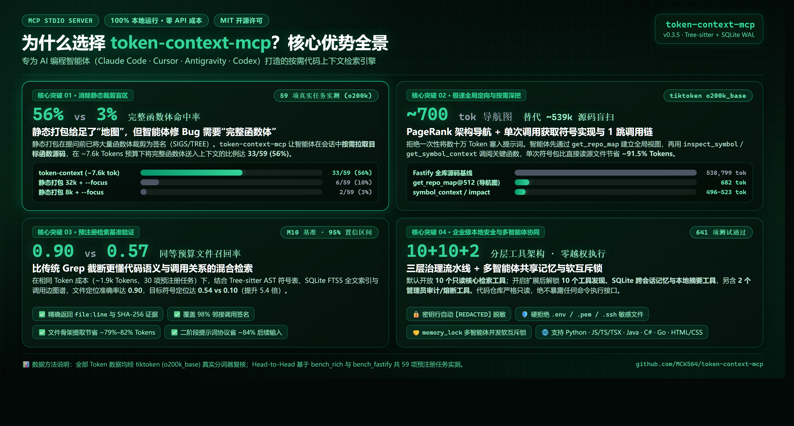
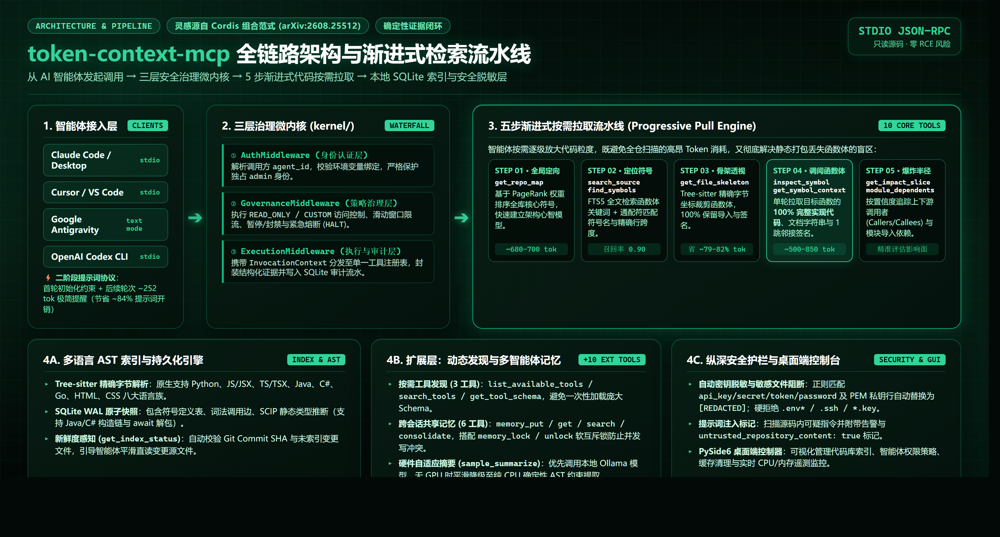
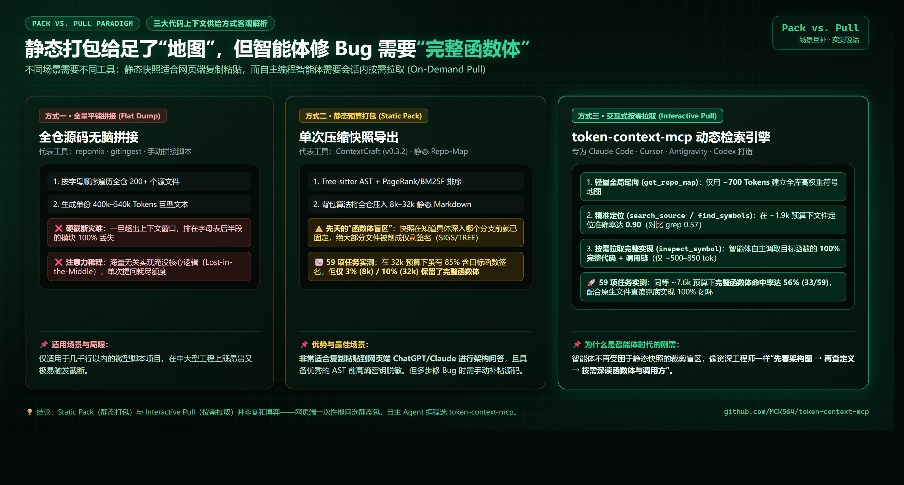
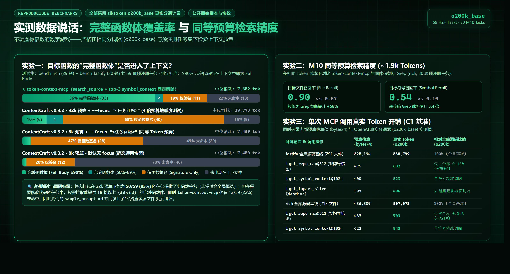
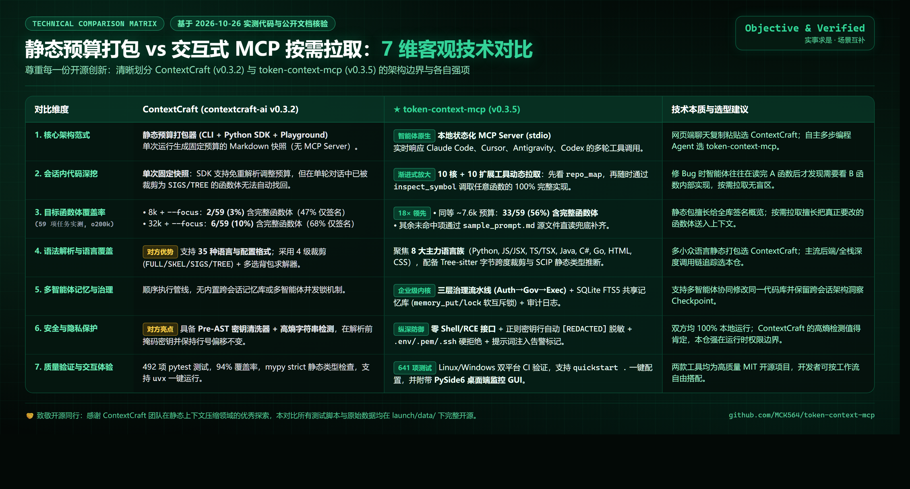

<!-- mcp-name: io.github.MCK564/token-context-mcp -->
# Token Context MCP (v0.3.5)

[](https://github.com/MCK564/token-context-mcp/actions/workflows/ci.yml)
[](https://pypi.org/project/token-context-mcp/)
[](https://www.python.org/)
[](LICENSE)

> 🌐 英文版: [`README.md`](README.md) | 🇻🇳 越南语版: [`README.vi.md`](README.vi.md) | 🇨🇳 简体中文: [`README.cn.md`](README.cn.md) | 📝 提示词协议: [`sample_prompt.md`](sample_prompt.md) | 📋 更新日志: [`CHANGELOG.md`](CHANGELOG.md)

> [!NOTE]
> **架构说明**：`token-context-mcp` 的三层预算治理微内核设计灵感源自 Cordis 论文（*A Programming Paradigm for Spatiotemporal Composability*, arXiv:2608.25512）。本项目是由社区独立维护的开源项目，与 DeepSeek 官方没有任何隶属或背书关系。

`token-context-mcp` 是专为多步自主 AI 编程智能体（Claude Code、Cursor、Codex、Google Antigravity）打造的**交互式、按需拉取（Interactive MCP Pull）、预算感知**的代码上下文 MCP 服务器。不同于将全库硬塞进 Prompt 的平铺打包或过度裁剪导致丢失函数实现的静态打包器，它通过 Tree-sitter AST 语法树与 SQLite WAL 调用图索引，为智能体渐进式交付带有精确 `file:line` + SHA-256 存证的代码片段与依赖切片。

---

## 🖼️ 架构设计与实测对比高清图集 (2x Retina 暗黑祖母绿)

<p align="center">
  
</p>

<details>
<summary><b>🔍 查看全部 4 张技术架构与实测对比图（点击展开）</b></summary>

### 1. 双阶段架构流水线与零膨胀三防线
<p align="center">
  
</p>

### 2. 静态预算打包 (Pack) vs 交互式按需拉取 (Pull) 范式对比
<p align="center">
  
</p>

### 3. 59 任务 Head-to-Head 实测 & M10 评测 & C1 调用成本
<p align="center">
  
</p>

### 4. 七维全景技术对比矩阵（对比 ContextCraft v0.3.2）
<p align="center">
  
</p>

</details>

---

## ⚡ 三大核心架构支柱

1. **三层预算治理微内核 (`kernel/`)**：
   - 每次调用均在统一轻量级流水线内受控执行：
     - **第一道防线（Clean AST-Boundary Cap）**：指定 `max_response_tokens` 并在 AST 语法块边界优雅截断，绝不产生半截残缺代码。
     - **第二道防线（Per-Tool Async Timeout）**：内置异步执行超时闸门（`get_repo_map` 10s、`search_source` 5s），防止超大仓库卡死会话。
     - **第三道防线（150K Session Budget Breaker）**：追踪全会话累计消耗，达到 80% 触发遥测告警，达到 **150,000 Token** 硬上限直接熔断拦截，防止死循环刷爆 API 账单。
2. **零工具定义膨胀（Zero Schema Bloat）**：
   - 默认 `tools/list` 仅暴露 **10 个核心只读检索与导航工具**（10 个扩展工具与 2 个管理工具默认隐藏）。服务端剥离 JSON Schema 冗余字段，大幅压低智能体启动阶段的 Prompt 基础开销。
3. **增量 Tree-sitter AST + SQLite WAL 持久化图索引 (`index/`)**：
   - 基于 `mtime_ns` + SHA-256 增量感知，全面覆盖 **Python, JS/TS, Go, Rust, Java, C/C++** 及 C#，内置符号链接防逃逸与越界路径校验。

---

## 📊 硬核实测数据（基于 `tiktoken o200k_base` 严格审计）

全部数据由 OpenAI `o200k_base` 分词器在两个典型真实开源代码库（`rich` Python 213 个文件 / 50.7 万 Token，`fastify` JS/TS 291 个文件 / 53.8 万 Token）上测得：

| 评测基准 | 指标项 | token-context-mcp | 对照组 / 基线 | 实测结论 |
| :--- | :--- | :---: | :---: | :--- |
| **59-Task Head-to-Head**（同等 ~7.6k Token 预算） | 目标函数保留完整代码实现（**Full Body** $\ge 90\%$） | **33 / 59 (55.9%)** | 2 / 59 (3.4%) *(ContextCraft 8k `--focus`)* | 同等预算下完整函数体命中率提升 **16.5 倍** |
| **59-Task H2H 敏感性分析**（对比 4 倍静态预算 32k） | 完整函数体 vs 仅剩函数签名 | **33 / 59 完整实现** (在 7.6k 预算) | 6 / 59 完整实现，**40 / 59 (67.8%) 仅剩函数签名** *(ContextCraft 32k)* | 静态打包为兼顾全仓地图被迫将大量函数截成签名；MCP 交互拉取可将 100% 预算聚焦在当前编辑函数 |
| **M10 同等预算评测**（`rich`, n=30, ~1.9k Token 预算） | 文件召回率 (File Recall) & 符号召回率 (Symbol Recall) | **0.90** 文件召回率<br/>**0.54** 符号召回率 | 0.57 文件召回率<br/>0.10 符号召回率 *(截断 Grep)* | 文件召回率 **+58%**，符号召回率提升 **5.4 倍** |
| **C1 单次调用成本**（`fastify` 53.8 万源码基线） | 仓库全景导航图 `get_repo_map@512` | **682 tokens** | 538,799 tokens（原始源码） | 骨干地图仅占全库 **0.13%**（体积缩小约 790 倍） |

---

## 🚀 极速上手 (Quick Start)

### 方式 1：使用 `uvx` 免安装直接运行（推荐）
```bash
# 自动为当前目录代码库建立索引并打印 Agent 连接配置
uvx token-context-mcp quickstart .
```

### 方式 2：使用 `pip` 安装
```bash
pip install token-context-mcp

# 注册代码仓库并启动服务
token-context register --repo-id my-project --root /path/to/project
token-context index --repo-id my-project
token-context serve
```

### 桌面图形控制台 (PySide6 Desktop GUI)
提供 CPU/RAM 硬件遥测、仓库管理与智能体安全状态监控：
```bash
uvx --from "token-context-mcp[gui]" token-context-gui
```

---

## 🤖 编程智能体接入配置

`token-context-mcp` 通过标准 `stdio` 协议交互，配置如下：

### 1. Claude Code
```bash
claude mcp add --transport stdio --scope user token-context -- uvx token-context-mcp serve
```

### 2. Cursor
打开 Cursor Settings > Features > MCP Servers:
- **Name**: `token-context`
- **Type**: `command`
- **Command**: `uvx token-context-mcp serve`

### 3. Claude Desktop
添加至 `%APPDATA%\Claude\claude_desktop_config.json`（Windows）或 `~/.config/Claude/claude_desktop_config.json`（macOS/Linux）：
```json
{
  "mcpServers": {
    "token-context": {
      "command": "uvx",
      "args": ["token-context-mcp", "serve"]
    }
  }
}
```

### 4. Google Antigravity / Gemini CLI
添加至 `mcp_config.json`：
```json
{
  "mcpServers": {
    "token-context": {
      "command": "uvx",
      "args": [
        "token-context-mcp",
        "serve",
        "--output-mode", "text",
        "--schema-profile", "gemini_safe"
      ]
    }
  }
}
```

---

## 🛠 10 个核心只读工具目录

默认配置下仅暴露 **10 个只读检索工具**：

| 工具名 | 主要功能 | 访问模式 |
| :--- | :--- | :---: |
| `list_repositories` | 列出已注册的 `repo_id`（绝不泄露底层绝对物理路径）。 | 只读 |
| `get_index_status` | 返回快照元数据、已索引文件数、commit SHA 与新鲜度。 | 只读 |
| `get_repo_map` | 基于 PageRank 与扇入扇出中心度的骨干符号地图（`@512`）。 | 只读 |
| `find_symbols` | 支持通配符（`*`, `?`）的符号模式匹配与行号定位。 | 只读 |
| `search_source` | FTS5 全文搜索，返回匹配行及包含该行的完整符号范围。 | 只读 |
| `get_file_skeleton` | 提取文件骨架（导入声明、类与函数签名，省略实现体）。 | 只读 |
| `get_symbol_context` | 获取目标函数完整源码（Full Body）、docstring 与调用方列表（`@1024`）。 | 只读 |
| `get_impact_slice` | 修改代码前一键分析下游依赖调用链（`depth=2`）。 | 只读 |
| `get_module_dependents` | 提取模块间 Tree-sitter import 依赖关系。 | 只读 |
| `inspect_symbol` | 复合导航流：符号解析 + 完整上下文 + 1-hop 影响图。 | 只读 |

*(包含多智能体 SQLite 共享内存 `memory_*`、动态工具发现 `*_tools`、代码本地压缩 `sample_summarize` 与管理工具 `agent_control`, `audit_logs` 在内的 12 个扩展/管理工具可通过配置开启)。*

---

## 🔒 安全保障与本地隐私承诺

- **无任意代码执行（No RCE）**：没有任何工具允许智能体执行任意 shell、bash 命令或修改仓库源文件。
- **100% 本地化运行**：所有 SQLite WAL 索引均存储于本地计算机，绝不向任何外部云端发送代码数据。
- **敏感信息自动脱敏**：内置敏感行检测与正则脱敏（自动替换为 `[REDACTED: potential secret]`），严防 `.env*`、`.ssh`、`*.pem` 等密钥外泄。

---

## 📚 详细技术文档

- [`sample_prompt.md`](sample_prompt.md)：标准双阶段智能体交互提示词模板（EN / VI / CN）。
- [`CHANGELOG.md`](CHANGELOG.md)：详细发布与升级记录。
- [`launch/00_fact_sheet.md`](launch/00_fact_sheet.md)：完整实测数据与复现指南。
- [`docs/CLIENT_MATRIX.md`](docs/CLIENT_MATRIX.md)：主流 MCP 客户端实测矩阵。

---
*由 Token Context MCP 社区维护。遵循开源 MIT 协议。*
