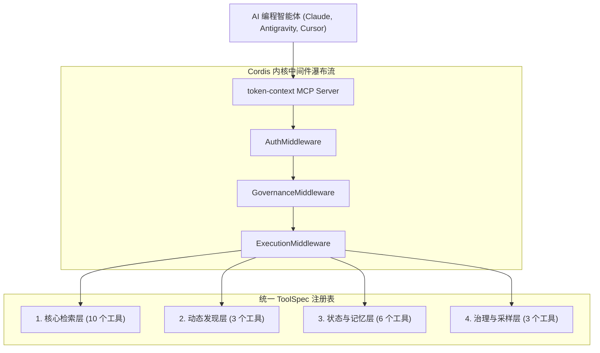

# Token Context MCP (v0.3.4)

[](https://github.com/MCK564/token-context-mcp/actions/workflows/ci.yml)
[](https://pypi.org/project/token-context-mcp/)
[](https://www.python.org/)
[](LICENSE)

> 🇻🇳 越南语版: [`README.md`](README.md) | 🌐 英文版: [`README.en.md`](README.en.md) | 📝 提示词模板: [`sample_prompt.md`](sample_prompt.md) | 📋 更新日志: [`CHANGELOG.md`](CHANGELOG.md) | 🔬 深度研究报告: [`DEEP_RESEARCH_MCP_AND_HARNESS_REPORT.md`](DEEP_RESEARCH_MCP_AND_HARNESS_REPORT.md)

`token-context-mcp` 是一个安全、轻量级、只读（read-only）的本地 **模型上下文协议（Model Context Protocol, MCP）** 服务器。它利用 Tree-sitter 抽象语法树（AST）和词法调用图（Lexical Call Graph）对代码库建立本地索引，向 AI 编程智能体（Claude Code、Google Antigravity、Cursor、Codex 等）按需交付高精度的渐进式上下文数据包（Context Packets），**在节省 60% 至 99% Token 消耗的同时**，彻底消除盲目全库扫描与上下文溢出问题。

自 **v0.3.4** 版本起，项目正式引入 **DeepSeek Harness & Cordis Framework**（“*万物皆插件 / Everything is a Plugin*”）架构，具备统一中间件瀑布流（Unified Middleware Waterfall）、声明式上下文批处理（Declarative Context Batching）以及解耦的服务提供者接缝（Provider Seams）。

---

## ⚡ v0.3.4 核心亮点（DeepSeek Harness & Cordis 架构）

1. **Cordis 内核与统一中间件瀑布流 (`kernel/`)**：
   - 全部执行流统一收敛至 `InvocationContext`，携带完整的智能体身份标识、可逆副作用日志（`EffectRecord`）以及基于 `contextvars` 的异步上下文传播。
   - 标准化三级流水线：`AuthMiddleware`（身份认证与环境变量绑定校验）➔ `GovernanceMiddleware`（权限策略执行、速率限制、紧急熔断）➔ `ExecutionMiddleware`（异常捕获与标准化错误翻译）。
   - 内核单次调度开销仅 **0.0109 ms/call**（吞吐量 >91,000 calls/sec）。
2. **声明式上下文批处理 (`retrieve/batch.py`)**：
   - 支持智能体在 **单次对话轮次（1 Turn）** 内串联执行多步检索流水线（例如：`find_symbols` ➔ `get_symbol_context`），消除多轮往返的通信与提示词重放开销。
   - 支持动态引用上一步结果：`"$prev.data.symbols[0].symbol_id"`。
   - 严格坚守只读安全边界：批处理内严禁任何状态写入或突变操作。
3. **AST 字节跨度函数体省略 (`sampling/skeleton_hybrid.py`)**：
   - 使用 Tree-sitter AST 的精确字节坐标（`body_start_byte` / `body_end_byte`）取代传统正则行切分，全面支持 Python、Java、TypeScript、C# 与 Go。
   - 100% 保留函数签名、装饰器、类结构与导入声明，同时安全剔除无关的函数实现体。
4. **推理大模型兼容层 (`sampling/router.py`)**：
   - 在 Pydantic JSON 解析前自动剥离推理模型（DeepSeek R1、Qwen-QwQ 等）输出的 `<think>...</think>` 思维链标签，杜绝格式校验崩溃。
5. **自定义 TOML 配置无损保留 (`config.py`)**：
   - `AppConfig.extra` 机制确保 `load_config` 与 `save_config` 在注册或更新仓库时，完整保留 `[plugins]`、`[harness]` 等非标扩展配置段。
6. **SCIP Oracle 与静态类型推断（合并自 `m14` 分支）**：
   - 引入 SCIP 基准真值对齐评估、高级静态类型推断、`await` 解包以及面向 Java/C# 的构造函数链解析。

---

## 🚀 5 分钟快速上手 (Quick Start)

### 环境要求
- **Python 3.12+** 及包管理器 **`uv`**（[安装 uv](https://astral.sh/uv)）。

### 一键极速启动（推荐）
在任意目标代码库目录下直接运行：
```powershell
uvx token-context-mcp quickstart .
```
系统将在数秒内完成仓库注册、AST 索引构建，并自动打印适用于 Claude Code、Cursor 与 Antigravity 的一键连接配置。

### 手动安装与索引流程
```powershell
# 1. 克隆仓库并同步依赖
git clone https://github.com/MCK564/token-context-mcp.git
cd token-context-mcp
uv sync --all-extras

# 2. 注册目标代码仓库
uv run token-context register --repo-id my-project --root D:\Work\my-project

# 3. 构建本地原子快照索引
uv run token-context index --repo-id my-project

# 4. 检查索引健康度与新鲜度
uv run token-context status --repo-id my-project

# 5. 启动 MCP stdio 服务器
uv run token-context serve
```

### 桌面图形控制台 (PySide6 Desktop GUI)
项目内置现代化桌面管理界面，支持实时硬件监控、CPU/RAM 遥测、调用图可视化与智能体安全管控：
```powershell
uv run token-context-gui
# 或在 Windows 下直接运行一键启动脚本：
.\scripts\launch_desktop_gui.bat
```

---

## 🤖 AI 编程智能体连接配置

`token-context-mcp` 通过标准 `stdio` 协议通信，只需将对应 JSON/TOML 配置加入您的客户端：

### 1. Claude Code / Claude Desktop
添加至 `%APPDATA%\Claude\claude_desktop_config.json`（Windows）或 `~/.config/Claude/claude_desktop_config.json`（macOS/Linux）：
```json
{
  "mcpServers": {
    "token-context": {
      "command": "uv",
      "args": [
        "run", "--no-sync",
        "--directory", "D:\\AI\\token-context-mcp",
        "python", "-m", "token_context_mcp.cli", "serve",
        "--transport", "stdio"
      ]
    }
  }
}
```
*或通过 Claude Code CLI 一键添加：*
```powershell
claude mcp add --transport stdio --scope user token-context -- uv run --no-sync --directory D:\AI\token-context-mcp python -m token_context_mcp.cli serve --transport stdio
```

### 2. Google Antigravity IDE & Gemini CLI
添加至 `mcp_config.json`：
```json
{
  "mcpServers": {
    "token-context": {
      "command": "uv",
      "args": [
        "run", "--no-sync",
        "--directory", "D:\\AI\\token-context-mcp",
        "token-context", "serve",
        "--output-mode", "text",
        "--schema-profile", "gemini_safe"
      ]
    }
  }
}
```
> **提示**：`--output-mode text` 与 `--schema-profile gemini_safe` 标志可确保 Gemini 系列模型完整接收数组结构并遵循严格类型约束。

### 3. OpenAI Codex & Cursor
添加至 `%USERPROFILE%\.codex\config.toml` 或 Cursor MCP 设置：
```toml
[mcp_servers.token-context]
command = "uv"
args = ["run", "--no-sync", "--directory", "D:\\AI\\token-context-mcp", "python", "-m", "token_context_mcp.cli", "serve", "--transport", "stdio"]
```

---

## 🛠 MCP 工具目录 (Tool Reference Catalog)

系统提供 **22 个结构化工具**，划分为 4 大功能层：



| 功能分组 | 工具名称 | 功能简述 | 访问模式 |
| :--- | :--- | :--- | :---: |
| **核心检索**<br>*(Core Retrieval)* | `list_repositories` | 列出已注册的 `repo_id`（绝不暴露底层文件系统绝对路径）。 | 只读 |
| | `get_index_status` | 查看索引快照元数据、Commit SHA、新鲜度及模糊边比例。 | 只读 |
| | `get_repo_map` | 在指定 Token 预算内按 PageRank 排序生成全库符号架构图。 | 只读 |
| | `find_symbols` | 支持通配符（`*`, `?`）的符号名称匹配，返回精确字节与行号跨度。 | 只读 |
| | `search_source` | 基于 SQLite FTS5 的全文代码检索，返回代码行片段及所属外围符号。 | 只读 |
| | `get_file_skeleton` | 提取文件骨架（导入、类与函数签名），省略函数体（节省约 95% Token）。 | 只读 |
| | `get_symbol_skeleton` / `get_symbol_context` | 获取单个符号的完整实现代码、文档字符串及调用者/被调用者。 | 只读 |
| | `get_impact_slice` | 按置信度过滤的影响面切片分析（Blast-radius 候选图遍历）。 | 只读 |
| | `get_module_dependents` | 基于 Tree-sitter 提取的模块级导入依赖关系。 | 只读 |
| | `inspect_symbol` | 单轮复合检索：符号解析 + 定义上下文 + 1 跳影响图（减少约 81% 提示词重放 Token）。 | 只读 |
| **动态发现**<br>*(Tool Discovery)* | `list_available_tools` | 按分类列出精简工具目录（避免全量 Schema 挤占上下文窗口）。 | 发现 |
| | `search_tools` | 根据任务意图关键词检索最匹配的工具及参数提示。 | 发现 |
| | `get_tool_schema` | 按需延迟加载指定工具的完整 JSON Schema。 | 发现 |
| **状态与记忆**<br>*(State & Memory)* | `memory_put` | 在本地 SQLite 中持久化多智能体共享结论、检查点与状态。 | 状态写入 |
| | `memory_get` | 按键名（Key）或会话 ID（Session ID）精确读取记忆项。 | 只读 |
| | `memory_search` | 基于 FTS5 按关键词或命名空间全文检索历史记忆。 | 只读 |
| | `memory_lock` | 带 TTL 超时的软互斥锁（Soft-Mutex），防止多智能体并发修改冲突。 | 状态写入 |
| | `memory_unlock` | 基于已验证的智能体身份释放互斥锁。 | 状态写入 |
| | `memory_consolidate` | 跨命名空间合并碎片化记忆并清理过期临时条目。 | 状态写入 |
| **治理与推理**<br>*(Gov & Sampling)* | `sample_summarize` | 硬件自适应代码摘要压缩（支持本地 Ollama 7B 或纯 CPU 确定性降级提取）。 | 推理采样 |
| | `agent_control` | 控制平面：暂停、恢复、封禁或紧急熔断违规智能体。 | 管理员 |
| | `audit_logs` | 查询安全审计日志、调用延迟与授权执行轨迹（SQLite WAL）。 | 管理员查询 |

---

## 💡 性能优化规范与标准提示词约束 (`sample_prompt.md`)

> **实现极致 Token 节省的必备规范 (MANDATORY BEST PRACTICE)**:
> `token-context-mcp` 在底层架构上为降低 80% 至 99% 的 AI 上下文消耗而专门优化。然而，如果智能体缺乏调用约束、盲目读取全部源文件，或者在每轮对话中机械地重复粘贴冗长的系统提示词，将会严重削弱本项目的性能优势。
>
> 📖 **完整提示词指南与模板：** [`sample_prompt.md`](sample_prompt.md)（提供简体中文 / 英语 / 越南语完整对照版本）

### 标准双阶段交互协议 (Two-Phase Turn Protocol):
1. **首轮初始化交互 (Turn 1 - Full Initialization)**:
   - 使用 [`sample_prompt.md`](sample_prompt.md) 中第 **3.1** 节（配备本地 Ollama）或第 **3.2** 节（纯 CPU 确定性模式）的完整模板。
   - 确立 **MCP 优先与源码平滑兜底** 原则：利用 `get_repo_map`、`find_symbols`、`inspect_symbol` 极速定位；遇代码截断或非 AST 配置文件时平滑直读目标文件，绝不擅自卡死在 `blocked` 状态。
2. **会话后续交互轮次 (Turn 2+ - Lightweight Follow-up)**:
   - **严禁在后续轮次中无脑重复粘贴全量提示词**，避免造成严重的输入 Token 膨胀与上下文挤占。
   - 直接使用 [`sample_prompt.md`](sample_prompt.md) 第 **3.3** 节提供的超精简后续提示词模板（仅约 10 行）：仅传入新任务，继承 MCP 定位约束与 6 点标准化输出格式。
   - 相比全量重放，会话后续轮次的输入 Token 消耗直降 **95% 以上**！

---

## 🔒 安全边界与隐私承诺 (Security Boundary)

- **杜绝远程代码执行 (No RCE)**：服务器严禁任何 Shell 命令执行、任意路径越界读取或动态 `eval` 调用。
- **严格的权限分层**：`admin` 身份受独占保护；常规智能体受 `READ_ONLY` 或 `CUSTOM` 策略约束。
- **100% 本地隐私保护**：所有 SQLite 索引快照与注册表均存储在本地个人设备（POSIX 下遵循 `0700` 目录与 `0600` 文件权限，Windows 下遵循 ACL 访问控制）。
- **提示词注入防御 (Prompt Injection Defense)**：从代码库检索的内容均包裹在安全隔离标记（`<<<SOURCE_CODE_START>>>` / `<<<SOURCE_CODE_END>>>`）中，并自动扫描潜在的提示词注入指令。

---

## 📚 技术参考文档

- [`sample_prompt.md`](sample_prompt.md)：面向 AI 智能体的自适应提示词模板（支持越南语 / 英语 / 简体中文）。
- [`CHANGELOG.md`](CHANGELOG.md)：完整版本历史与升级指南。
- [`docs/progress/RUN_LEDGER_H.md`](docs/progress/RUN_LEDGER_H.md)：DeepSeek Harness 架构演进台账与基准测试。
- [`docs/BENCHMARK.md`](docs/BENCHMARK.md)：独立测试集上的检索质量与 Token 压缩率基准评估。
- [`docs/PROMPTING.en.md`](docs/PROMPTING.en.md)：高 Token 效率的提问策略与提示词工程指南。
- [`docs/SECURITY_ASSURANCE.md`](docs/SECURITY_ASSURANCE.md)：系统安全保证架构报告。

---
*由 Token Context MCP 社区开发与维护。遵循 MIT 开源许可证。*
