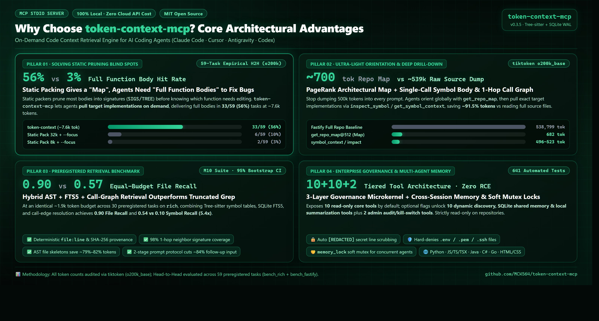
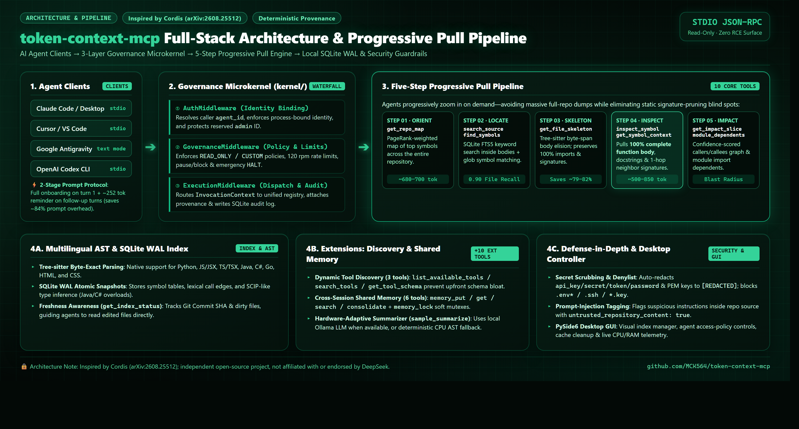
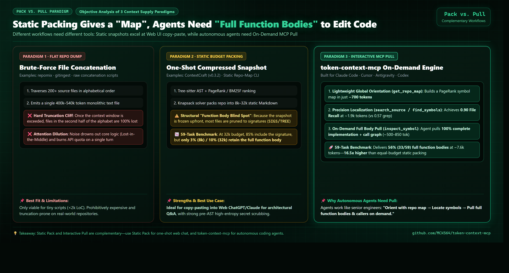
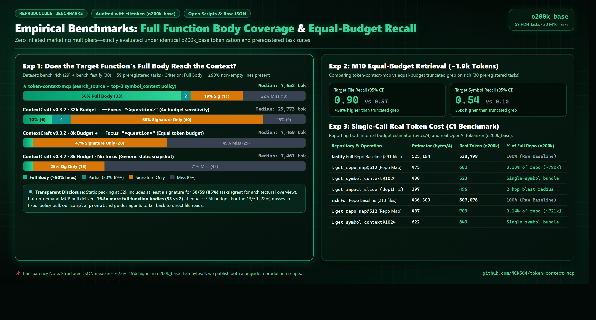
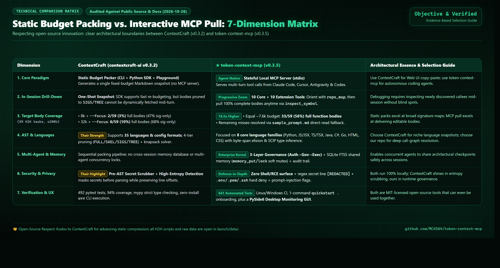

<!-- mcp-name: io.github.MCK564/token-context-mcp -->
# Token Context MCP (v0.3.5)

[](https://github.com/MCK564/token-context-mcp/actions/workflows/ci.yml)
[](https://pypi.org/project/token-context-mcp/)
[](https://www.python.org/)
[](LICENSE)

> 🌐 English: [`README.md`](README.md) | 🇻🇳 Tiếng Việt: [`README.vi.md`](README.vi.md) | 🇨🇳 简体中文: [`README.cn.md`](README.cn.md) | 📝 Prompt Protocol: [`sample_prompt.md`](sample_prompt.md) | 📋 Changelog: [`CHANGELOG.md`](CHANGELOG.md)

> [!NOTE]
> **Architecture Notice**: The governance microkernel design is inspired by the Cordis paper (*A Programming Paradigm for Spatiotemporal Composability*, arXiv:2608.25512). This is an independent open-source implementation not affiliated with or endorsed by DeepSeek.

`token-context-mcp` is an on-demand, budget-governed **Model Context Protocol (MCP)** server for autonomous AI coding agents (Claude Code, Cursor, Codex, Google Antigravity). Instead of blindly dumping an entire repository or compressing it into a static snapshot that strips function bodies down to signatures, it provides an **interactive AST-level pull pipeline** that delivers exact code symbols and downstream impact graphs with verified `file:line` + SHA-256 evidence.

---

## 🖼️ Architecture & Benchmark Infographics (2x Retina Dark Green)

<p align="center">
  
</p>

<details>
<summary><b>🔍 View detailed technical architecture & comparison diagrams (Click to expand)</b></summary>

### 1. 3-Layer Governance Microkernel & 5-Step Progressive Pull Pipeline
<p align="center">
  
</p>

### 2. Context Paradigms: Flat Dump vs. Static Pack vs. Interactive MCP Pull
<p align="center">
  
</p>

### 3. Empirical Benchmarks: 59-Task Head-to-Head & M10 Equal-Budget Suite
<p align="center">
  
</p>

### 4. 7-Dimension Technical Comparison Matrix (vs. ContextCraft v0.3.2)
<p align="center">
  
</p>

</details>

---

## ⚡ Core Architectural Pillars

1. **3-Layer Governance Microkernel (`kernel/`)**:
   - Every request is governed by a lightweight execution pipeline:
     - **Layer 1 — Clean AST-Boundary Cap**: Enforces `max_response_tokens` at syntactic boundaries without cutting functions in half.
     - **Layer 2 — Per-Tool Async Timeout Gate**: Prevents runaway hangs on large monorepos (`10s` for `get_repo_map`, `5s` for `search_source`).
     - **Layer 3 — 150K Session Budget Circuit Breaker**: Emits a telemetry warning at 80% usage and halts runaway loops at **150,000 cumulative tokens** to prevent bill shocks.
2. **Zero Schema Bloat**:
   - The default `tools/list` payload exposes **only 10 core read-only retrieval tools** (keeping 10 extension tools and 2 admin tools off the wire until requested). Server-side JSON schemas are slimmed to reduce initial prompt tax.
3. **Incremental Tree-sitter AST & Persistent SQLite Graph (`index/`)**:
   - Fast `mtime_ns` + SHA-256 change detection across **Python, JavaScript/TypeScript, Go, Rust, Java, C/C++**, and C# with symlink-escape and path traversal guards.

---

## 📊 Empirical Benchmarks (`tiktoken o200k_base` Audited)

All numbers are measured using OpenAI's `o200k_base` tokenizer across two real-world open-source repositories: `rich` (Python, 213 files, 507k tokens) and `fastify` (JS/TS, 291 files, 538k tokens):

| Benchmark Suite | Metric | token-context-mcp | Baseline / Alternative | Empirical Takeaway |
| :--- | :--- | :---: | :---: | :--- |
| **59-Task Head-to-Head** (Equal budget: ~7.6k tokens) | Target function in context with **Full Body** ($\ge 90\%$ lines) | **33 / 59 (55.9%)** | 2 / 59 (3.4%) *(ContextCraft 8k `--focus`)* | **16.5× more full function bodies** at equal token budget |
| **59-Task H2H (Sensitivity)** (vs. 4× static budget: 32k tokens) | Full Body vs. Signature Only | **33 / 59 Full Body** (at 7.6k) | 6 / 59 Full Body, **40 / 59 (67.8%) Signature Only** *(ContextCraft 32k)* | Static packing prunes bodies to signatures to fit whole-repo maps; interactive MCP pull focuses 100% of budget on the target symbol |
| **M10 Equal-Budget Suite** (`rich`, n=30, ~1.9k tokens) | File Recall & Symbol Recall (95% Bootstrap CI) | **0.90** File Recall<br/>**0.54** Symbol Recall | 0.57 File Recall<br/>0.10 Symbol Recall *(Truncated Grep)* | **+58% file recall**, **5.4× symbol recall** over truncated grep at identical token cost |
| **C1 Single-Call Cost** (`fastify` 538k source baseline) | Orientation map `get_repo_map@512` | **682 tokens** | 538,799 tokens (raw source files) | Compact repo map occupies **0.13%** of the repository (~790× smaller) |

---

## 🚀 Quick Start

### Option 1: Run instantly with `uvx` (Recommended)
```bash
# Register, index, and print agent config for the current directory
uvx token-context-mcp quickstart .
```

### Option 2: Install via `pip`
```bash
pip install token-context-mcp

# Register a codebase and launch server
token-context register --repo-id my-project --root /path/to/project
token-context index --repo-id my-project
token-context serve
```

### Desktop GUI Controller (PySide6)
Includes hardware telemetry, CPU/RAM monitoring, and repository status overview:
```bash
uvx --from "token-context-mcp[gui]" token-context-gui
```

---

## 🤖 Coding Agent Setup

`token-context-mcp` communicates over local `stdio`. Add the configuration below to your agent:

### 1. Claude Code
```bash
claude mcp add --transport stdio --scope user token-context -- uvx token-context-mcp serve
```

### 2. Cursor
In Cursor Settings > Features > MCP Servers:
- **Name**: `token-context`
- **Type**: `command`
- **Command**: `uvx token-context-mcp serve`

### 3. Claude Desktop
Add to `%APPDATA%\Claude\claude_desktop_config.json` (Windows) or `~/.config/Claude/claude_desktop_config.json` (macOS/Linux):
```json
{
  "mcpServers": {
    "token-context": {
      "command": "uvx",
      "args": ["token-context-mcp", "serve"]
    }
  }
}
```

### 4. Google Antigravity IDE / Gemini CLI
Add to `mcp_config.json`:
```json
{
  "mcpServers": {
    "token-context": {
      "command": "uvx",
      "args": [
        "token-context-mcp",
        "serve",
        "--output-mode", "text",
        "--schema-profile", "gemini_safe"
      ]
    }
  }
}
```

---

## 🛠 Tool Reference Catalog (10 Default Core Tools)

By default, the server exposes **10 read-only retrieval tools** to preserve agent context:

| Tool | Primary Purpose | Mode |
| :--- | :--- | :---: |
| `list_repositories` | Lists registered `repo_id`s (filesystem root paths are never leaked). | Read-only |
| `get_index_status` | Returns snapshot metadata, indexed file count, commit SHA, and freshness. | Read-only |
| `get_repo_map` | PageRank-based symbol hierarchy within a token budget (`@512`). | Read-only |
| `find_symbols` | Pattern-based symbol matching (`*`, `?` wildcards) with file coordinates. | Read-only |
| `search_source` | FTS5 code search returning matched lines and enclosing symbol spans. | Read-only |
| `get_file_skeleton` | File outline (imports, class/function signatures with elided bodies). | Read-only |
| `get_symbol_context` | Full function/class body, docstrings, and callers/callees (`@1024`). | Read-only |
| `get_impact_slice` | Traverses downstream call graph dependencies before making changes (`depth=2`). | Read-only |
| `get_module_dependents` | Tree-sitter import dependency graph between modules. | Read-only |
| `inspect_symbol` | Composite lookup: symbol resolution + full context + 1-hop impact graph. | Read-only |

*(10 extension tools including SQLite multi-agent memory `memory_*`, lazy tool discovery `*_tools`, hardware-adaptive compressor `sample_summarize`, and 2 admin tools `agent_control`, `audit_logs` can be enabled via configuration).*

---

## 🔒 Security Guarantees & Privacy

- **No Remote Code Execution (RCE)**: No tool can execute shell commands, eval code, or modify repository source files.
- **100% Local & Private**: All SQLite WAL indexes remain on your machine; zero cloud telemetry or external API calls.
- **Automatic Secret Redaction**: Regex-based redaction of API keys, tokens, and private keys (`[REDACTED: potential secret]`) plus hard denial of sensitive files (`.env*`, `.ssh`, `*.pem`, `id_rsa`).

---

## 📚 Technical Documentation

- [`sample_prompt.md`](sample_prompt.md): Standard two-phase prompt templates (EN / VI / CN).
- [`CHANGELOG.md`](CHANGELOG.md): Release history and upgrade notes.
- [`launch/00_fact_sheet.md`](launch/00_fact_sheet.md): Verified empirical benchmarks and measurement methodologies.
- [`docs/CLIENT_MATRIX.md`](docs/CLIENT_MATRIX.md): Step-by-step MCP client verification matrix.

---
*Maintained by the Token Context MCP community. Licensed under MIT.*
