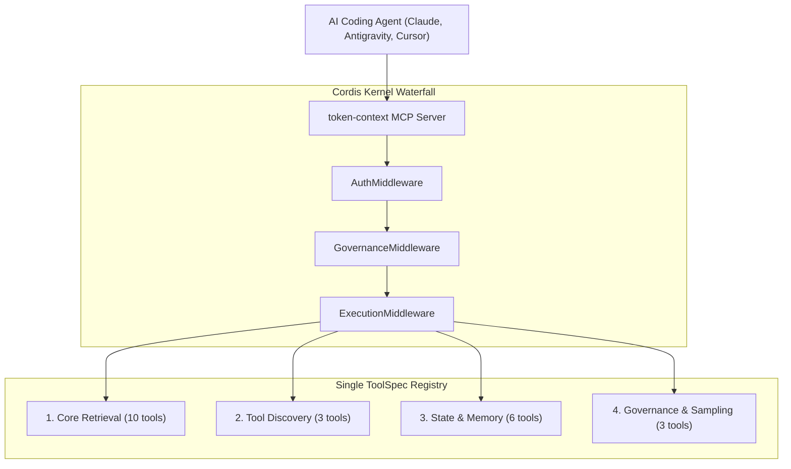

# Token Context MCP (v0.3.4)

[](https://github.com/MCK564/token-context-mcp/actions/workflows/ci.yml)
[](https://pypi.org/project/token-context-mcp/)
[](https://www.python.org/)
[](LICENSE)

> 🇻🇳 Vietnamese edition: [`README.md`](README.md) | 🇨🇳 简体中文: [`README.cn.md`](README.cn.md) | 📝 Prompt Templates: [`sample_prompt.md`](sample_prompt.md) | 📋 Changelog: [`CHANGELOG.md`](CHANGELOG.md) | 🔬 Research Report: [`DEEP_RESEARCH_MCP_AND_HARNESS_REPORT.md`](DEEP_RESEARCH_MCP_AND_HARNESS_REPORT.md)

`token-context-mcp` is a secure, lightweight, read-only local **Model Context Protocol (MCP)** server that indexes code repositories using Tree-sitter Abstract Syntax Trees (AST) and lexical call graphs. It delivers compact, high-precision context packets to AI Coding Agents (Claude Code, Google Antigravity, Cursor, Codex), **reducing token consumption by 60% to 90%** while eliminating broad, blind repository crawling.

Starting with **v0.3.4**, the project adopts the **DeepSeek Harness & Cordis Framework** ("*Everything is a Plugin*") architecture with a unified middleware waterfall, declarative context batching, and decoupled provider seams.

---

## ⚡ Highlights in Version 0.3.4 (DeepSeek Harness & Cordis Architecture)

1. **Cordis Kernel & Unified Middleware Waterfall (`kernel/`)**:
   - Centralized execution flow through `InvocationContext`, carrying caller identity, reversible effect logs (`EffectRecord`), and async context propagation via `contextvars`.
   - Unified stage pipeline: `AuthMiddleware` (identity & env-bound checks) ➔ `GovernanceMiddleware` (policy enforcement, emergency halt, rate limits) ➔ `ExecutionMiddleware` (domain error formatting).
   - Internal dispatch overhead is merely **0.0109 ms/call** (>91,000 calls/sec).
2. **Declarative Context Batching (`retrieve/batch.py`)**:
   - Enables agents to execute multi-step context retrieval workflows (e.g. `find_symbols` ➔ `get_symbol_context`) in a **single turn**, eliminating roundtrip communication overhead.
   - Supports dynamic reference templating: `"$prev.data.symbols[0].symbol_id"`.
   - Strictly enforces read-only invariants: mutating operations are completely rejected.
3. **AST Byte-Span Body Elision (`sampling/skeleton_hybrid.py`)**:
   - Replaced regex line splitting with exact Tree-sitter AST byte coordinates (`body_start_byte`/`body_end_byte`) across Python, Java, TypeScript, C#, and Go.
   - Preserves 100% of header/signature syntax, imports, and class declarations while cleanly eliding irrelevant method bodies.
4. **Reasoning Model Compatibility (`sampling/router.py`)**:
   - Automatically sanitizes `<think>...</think>` tags from reasoning LLMs (DeepSeek R1, Qwen-QwQ) prior to Pydantic JSON parsing, preventing schema validation failures.
5. **Custom TOML Section Roundtrip Preservation (`config.py`)**:
   - `AppConfig.extra` ensures non-standard tables like `[plugins]` and `[harness]` are preserved across repository registration and update operations.
6. **SCIP Oracle & Static Type Inference (merged from `m14`)**:
   - Incorporates SCIP ground truth evaluation, static type inference, `await` unwrapping, and constructor chaining for Java and C#.

---

## 🚀 Quick Start (5 minutes)

### Prerequisites
- **Python 3.12+** and **`uv`** package manager ([Install uv](https://astral.sh/uv)).

```powershell
# 1. Clone repository and install dependencies
git clone https://github.com/your-org/token-context-mcp.git
cd token-context-mcp
uv sync --all-extras

# 2. Register your target repository
uv run token-context register --repo-id my-project --root D:\Work\my-project

# 3. Build initial atomic index
uv run token-context index --repo-id my-project

# 4. Check index health & freshness
uv run token-context status --repo-id my-project

# 5. Start MCP stdio server
uv run token-context serve
```

### Desktop GUI Controller (PySide6)
Includes a modern desktop GUI featuring live CPU/RAM telemetry, visual repository management, call graph visualization, and agent security controls:
```powershell
uv run token-context-gui
# Or run 1-click launcher on Windows:
.\scripts\launch_desktop_gui.bat
```

---

## 🤖 Coding Agent Client Configuration

`token-context-mcp` communicates over local `stdio`. Add the appropriate snippet to your tool's MCP configuration:

### 1. Claude Code / Claude Desktop
Add to `%APPDATA%\Claude\claude_desktop_config.json` (Windows) or `~/.config/Claude/claude_desktop_config.json` (macOS/Linux):
```json
{
  "mcpServers": {
    "token-context": {
      "command": "uv",
      "args": [
        "run", "--no-sync",
        "--directory", "D:\\AI\\token-context-mcp",
        "python", "-m", "token_context_mcp.cli", "serve",
        "--transport", "stdio"
      ]
    }
  }
}
```
*Or via Claude Code CLI:*
```powershell
claude mcp add --transport stdio --scope user token-context -- uv run --no-sync --directory D:\AI\token-context-mcp python -m token_context_mcp.cli serve --transport stdio
```

### 2. Google Antigravity IDE & Gemini CLI
Add to `mcp_config.json`:
```json
{
  "mcpServers": {
    "token-context": {
      "command": "uv",
      "args": [
        "run", "--no-sync",
        "--directory", "D:\\AI\\token-context-mcp",
        "token-context", "serve",
        "--output-mode", "text",
        "--schema-profile", "gemini_safe"
      ]
    }
  }
}
```
> **Tip**: Flags `--output-mode text` and `--schema-profile gemini_safe` ensure Gemini models receive complete, uncollapsed arrays and strictly typed inputs.

### 3. OpenAI Codex & Cursor
Add to `%USERPROFILE%\.codex\config.toml` or Cursor MCP settings:
```toml
[mcp_servers.token-context]
command = "uv"
args = ["run", "--no-sync", "--directory", "D:\\AI\\token-context-mcp", "python", "-m", "token_context_mcp.cli", "serve", "--transport", "stdio"]
```

---

## 🛠 Tool Reference Catalog

The system provides **22 structured tools** grouped into 4 functional tiers:



| Group | Tool | Description | Access Mode |
| :--- | :--- | :--- | :---: |
| **Core Retrieval** *(10 tools)* | `list_repositories` | Lists registered `repo_id`s (filesystem roots are never exposed). | Read-only |
| | `get_index_status` | Snapshot metadata, commit SHA, freshness, and ambiguous edge rate. | Read-only |
| | `get_repo_map` | PageRank-based definitions map within a token budget. | Read-only |
| | `find_symbols` | Pattern-based symbol matching (`*`, `?` wildcards) with span metadata. | Read-only |
| | `search_source` | FTS5 code search returning line spans and enclosing symbols. | Read-only |
| | `get_file_skeleton` | File outline (imports, class/function signatures) with elided bodies (~95% token savings). | Read-only |
| | `get_symbol_context` | Full symbol body, docstrings, and callers/callees. | Read-only |
| | `get_impact_slice` | Blast-radius candidate traversal filtered by confidence. | Read-only |
| | `get_module_dependents` | Tree-sitter import dependency relationships. | Read-only |
| | `inspect_symbol` | Composite workflow: candidate resolution + definition context + 1-hop impact (~81% prompt replay token savings). | Read-only |
| **Tool Discovery** *(3 tools)* | `list_available_tools` | Compact tool catalog without bulky schemas (prevents context tax). | Discovery |
| | `search_tools` | Keyword-based tool search by intent. | Discovery |
| | `get_tool_schema` | On-demand parameter schema retrieval for specific tools. | Discovery |
| **State & Memory** *(6 tools)* | `memory_put` | Stores multi-agent artifacts and state checkpoints in SQLite. | Mutating |
| | `memory_get` | Reads state by key or session ID. | Read-only |
| | `memory_search` | FTS5 text search over stored memories by namespace. | Read-only |
| | `memory_lock` | Soft-mutex lock with TTL to prevent multi-agent race conditions. | Mutating |
| | `memory_unlock` | Releases mutex lock under verified agent identity. | Mutating |
| | `memory_consolidate` | Deduplicates and prunes stale memories in a namespace. | Mutating |
| **Governance & Sampling** *(3 tools)* | `sample_summarize` | Hardware-adaptive code compression (Ollama 7B or heuristic CPU fallback). | Inference |
| | `agent_control` | Control plane: pause, resume, block, or emergency halt agents. | Admin |
| | `audit_logs` | Security, latency, and authorization audit trail (SQLite WAL). | Admin Query |

---

## 🔒 Security Boundary & Guarantees

- **No Remote Code Execution (RCE)**: The server strictly disallows arbitrary shell command execution, arbitrary path reads, or dynamic eval.
- **Access Control Plane**: `admin` identity is reserved and strictly protected; standard agent identities operate under `READ_ONLY` or `CUSTOM` policy enforcement.
- **Local Privacy**: Snapshots and SQLite registries are stored locally with strict file permissions (`0700` directories, `0600` files on POSIX / ACL restrictions on Windows).
- **Prompt Injection Defense**: Repository content is delimited in guarded tags (`<<<SOURCE_CODE_START>>>` / `<<<SOURCE_CODE_END>>>`) and scanned for prompt injection attacks.

---

## 📚 Technical Documentation

- [`CHANGELOG.md`](CHANGELOG.md): Comprehensive release history and upgrade guide.
- [`docs/progress/RUN_LEDGER_H.md`](docs/progress/RUN_LEDGER_H.md): DeepSeek Harness implementation ledger & benchmarks.
- [`docs/BENCHMARK.md`](docs/BENCHMARK.md): Retrieval quality benchmarks on held-out repositories.
- [`docs/PROMPTING.en.md`](docs/PROMPTING.en.md): Guidance and templates for token-efficient prompts.
- [`docs/SECURITY_ASSURANCE.md`](docs/SECURITY_ASSURANCE.md): Complete security assurance documentation.

---
*Maintained by the Token Context MCP community. Licensed under MIT.*
