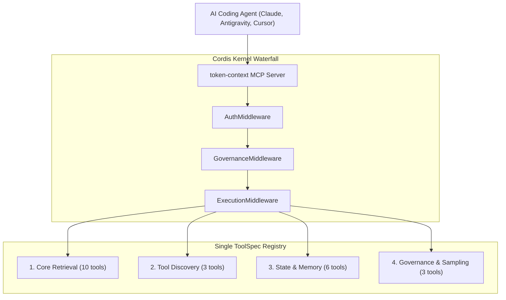

# Token Context MCP (v0.3.4)

[](https://github.com/MCK564/token-context-mcp/actions/workflows/ci.yml)
[](https://pypi.org/project/token-context-mcp/)
[](https://www.python.org/)
[](LICENSE)

> 🌐 English edition: [`README.en.md`](README.en.md) | 🇨🇳 简体中文: [`README.cn.md`](README.cn.md) | 📝 Mẫu Prompt: [`sample_prompt.md`](sample_prompt.md) | 📋 Chi tiết thay đổi: [`CHANGELOG.md`](CHANGELOG.md) | 🔬 Báo cáo nghiên cứu: [`DEEP_RESEARCH_MCP_AND_HARNESS_REPORT.md`](DEEP_RESEARCH_MCP_AND_HARNESS_REPORT.md)

`token-context-mcp` là một **Local Model Context Protocol (MCP) Server** bảo mật, siêu nhẹ, chỉ đọc (read-only), được thiết kế để lập chỉ mục mã nguồn bằng Abstract Syntax Tree (Tree-sitter) và đồ thị phụ thuộc từ vựng. Server cung cấp các gói ngữ cảnh chính xác cao (context packets) giúp các AI Coding Agent (Claude Code, Antigravity, Cursor, Codex) định vị và giải quyết tác vụ mà **tiết kiệm từ 60% đến 90% token**, loại bỏ tình trạng đọc tràn lan toàn bộ kho mã nguồn.

Từ phiên bản **v0.3.4**, dự án chính thức áp dụng kiến trúc **DeepSeek Harness & Cordis Framework** ("*Everything is a Plugin*") với Middleware Waterfall hợp nhất, Context Batching khai báo và Provider Seams.

---

## ⚡ Điểm mới nổi bật ở phiên bản 0.3.4 (DeepSeek Harness & Cordis Architecture)

1. **Kiến trúc Nhân Cordis & Thác Middleware Thống Nhất (`kernel/`)**:
   - Toàn bộ luồng thực thi chuyển sang `InvocationContext` mang đầy đủ danh tính agent, nhật ký hiệu ứng khả nghịch (`EffectRecord`), và lan truyền ngữ cảnh qua `contextvars`.
   - Chuỗi middleware xử lý tuần tự: `AuthMiddleware` (xác thực danh tính) ➔ `GovernanceMiddleware` (kiểm soát quyền, rate limit, dừng khẩn cấp) ➔ `ExecutionMiddleware` (bắt và dịch lỗi chuẩn hóa).
   - Độ trễ điều phối nội bộ chỉ **0.0109 ms/call** (>91.000 calls/sec).
2. **Context Batching Khai Báo (`retrieve/batch.py`)**:
   - Cho phép Agent chạy chuỗi truy xuất nhiều bước (ví dụ: `find_symbols` ➔ `get_symbol_context`) trong **chỉ 1 turn duy nhất** thay vì phải qua nhiều vòng hỏi-đáp máy trạm.
   - Hỗ trợ tham chiếu động kết quả bước trước: `"$prev.data.symbols[0].symbol_id"`.
   - Giữ nghiêm ngặt ranh giới an toàn: cấm tuyệt đối mọi tác vụ ghi hoặc đột biến state trong batch.
3. **AST Byte-Span Body Elision (`sampling/skeleton_hybrid.py`)**:
   - Thay thế việc cắt code bằng regex thủ công bằng tọa độ byte chính xác từ Tree-sitter AST (`body_start_byte`/`body_end_byte`) cho Python, Java, TypeScript, C#, Go.
   - Bảo toàn 100% cú pháp header/signature, class structure và imports trong khi loại bỏ thân hàm không liên quan một cách an toàn.
4. **Tương thích Reasoning LLM (`sampling/router.py`)**:
   - Tự động bóc tách sạch sẽ các thẻ suy luận nội tâm `<think>...</think>` của các mô hình reasoning (DeepSeek R1, Qwen-QwQ) trước khi parse JSON, ngăn chặn lỗi crash Pydantic.
5. **Bảo toàn Cấu hình TOML Tùy Biến (`config.py`)**:
   - Cơ chế `AppConfig.extra` giúp `load_config` và `save_config` lưu giữ nguyên vẹn các bảng tùy chọn ngoài chuẩn như `[plugins]`, `[harness]`.
6. **SCIP Oracle & Kiểu Dữ Liệu Tĩnh (nhánh `m14`)**:
   - Bổ sung bộ đối chiếu SCIP Oracle, suy luận kiểu tĩnh nâng cao, unwrapping `await` và liên kết chuỗi constructor cho Java/C#.

---

## 🚀 Khởi động nhanh trong 5 phút (Quick Start)

### Yêu cầu tiên quyết
- **Python 3.12+** và công cụ quản lý package **`uv`** ([Tải uv](https://astral.sh/uv)).

```powershell
# 1. Clone repository và cài đặt môi trường
git clone https://github.com/your-org/token-context-mcp.git
cd token-context-mcp
uv sync --all-extras

# 2. Đăng ký repository mã nguồn của bạn
uv run token-context register --repo-id my-project --root D:\Work\my-project

# 3. Lập chỉ mục ban đầu (chạy nền cực nhanh)
uv run token-context index --repo-id my-project

# 4. Kiểm tra trạng thái index
uv run token-context status --repo-id my-project

# 5. Khởi động server MCP stdio
uv run token-context serve
```

### Desktop GUI Controller (PySide6)
Dự án đi kèm giao diện đồ họa trực quan, giám sát phần cứng, telemetry CPU/RAM, trực quan hóa đồ thị gọi và cấu hình bảo mật agent:
```powershell
uv run token-context-gui
# Hoặc chạy launcher 1-click trên Windows:
.\scripts\launch_desktop_gui.bat
```

---

## 🤖 Cấu hình kết nối cho các Coding Agent

`token-context-mcp` giao tiếp qua chuẩn `stdio`. Bạn chỉ cần thêm cấu hình JSON vào công cụ lập trình yêu thích của mình:

### 1. Claude Code / Claude Desktop
Thêm vào `%APPDATA%\Claude\claude_desktop_config.json` (Windows) hoặc `~/.config/Claude/claude_desktop_config.json` (macOS/Linux):
```json
{
  "mcpServers": {
    "token-context": {
      "command": "uv",
      "args": [
        "run", "--no-sync",
        "--directory", "D:\\AI\\token-context-mcp",
        "python", "-m", "token_context_mcp.cli", "serve",
        "--transport", "stdio"
      ]
    }
  }
}
```
*Hoặc thêm nhanh qua Claude Code CLI:*
```powershell
claude mcp add --transport stdio --scope user token-context -- uv run --no-sync --directory D:\AI\token-context-mcp python -m token_context_mcp.cli serve --transport stdio
```

### 2. Google Antigravity IDE & Gemini CLI
Thêm vào file cấu hình MCP (`mcp_config.json`):
```json
{
  "mcpServers": {
    "token-context": {
      "command": "uv",
      "args": [
        "run", "--no-sync",
        "--directory", "D:\\AI\\token-context-mcp",
        "token-context", "serve",
        "--output-mode", "text",
        "--schema-profile", "gemini_safe"
      ]
    }
  }
}
```
> **Mẹo**: Cờ `--output-mode text` và `--schema-profile gemini_safe` giúp các mô hình dòng Gemini hiển thị trọn vẹn mảng dữ liệu mà không bị tóm tắt rút gọn.

### 3. OpenAI Codex & Cursor
Thêm vào `%USERPROFILE%\.codex\config.toml` hoặc Cursor MCP settings:
```toml
[mcp_servers.token-context]
command = "uv"
args = ["run", "--no-sync", "--directory", "D:\\AI\\token-context-mcp", "python", "-m", "token_context_mcp.cli", "serve", "--transport", "stdio"]
```

---

## 🛠 Danh mục Công cụ MCP (Tool Catalog)

Hệ thống cung cấp **22 công cụ** có cấu trúc chặt chẽ, chia làm 4 nhóm chức năng:



| Nhóm | Tên công cụ | Mô tả tóm tắt | Chế độ |
| :--- | :--- | :--- | :---: |
| **Truy xuất cốt lõi** *(Core Retrieval)* | `list_repositories` | Liệt kê danh sách `repo_id` đã đăng ký (ẩn đường dẫn ổ đĩa tuyệt đối). | Read-only |
| | `get_index_status` | Trạng thái index, snapshot metadata, commit SHA và tỷ lệ cạnh mơ hồ. | Read-only |
| | `get_repo_map` | Bản đồ định nghĩa toàn repo xếp hạng theo PageRank trong ngân sách token. | Read-only |
| | `find_symbols` | Tìm kiếm symbol theo tên/khớp mẫu wildcard (`*`, `?`), trả về span. | Read-only |
| | `search_source` | Tìm kiếm toàn văn FTS5 trong thân hàm và file nguồn, trả về đoạn mã kèm dòng. | Read-only |
| | `get_file_skeleton` | Bóc tách khung xương file (import, chữ ký class/hàm), giấu thân hàm (tiết kiệm ~95% token). | Read-only |
| | `get_symbol_context` | Chi tiết đầy đủ của 1 symbol (thân hàm, docstring, danh sách caller/callee). | Read-only |
| | `get_impact_slice` | Phân tích lát cắt ảnh hưởng (blast-radius graph) lọc theo độ tin cậy. | Read-only |
| | `get_module_dependents` | Đồ thị quan hệ phụ thuộc import trích xuất từ Tree-sitter. | Read-only |
| | `inspect_symbol` | Truy xuất tích hợp: resolve + context + 1-hop impact graph (giảm 81% prompt tokens). | Read-only |
| **Khám phá động** *(Tool Discovery)* | `list_available_tools` | Liệt kê danh mục công cụ rút gọn theo phân loại (chống tràn context window). | Discovery |
| | `search_tools` | Tìm kiếm công cụ phù hợp theo từ khóa tác vụ. | Discovery |
| | `get_tool_schema` | Nạp JSON Schema chi tiết của công cụ theo nhu cầu gọi thực tế. | Discovery |
| **Trạng thái & Bộ nhớ** *(State & Memory)* | `memory_put` | Lưu trữ checkpoint, state hoặc artifact dùng chung giữa các agent. | State Mutating |
| | `memory_get` | Đọc lại state/ký ức theo key hoặc session_id. | Read-only |
| | `memory_search` | Tìm kiếm ký ức bằng FTS5 theo từ khóa hoặc namespace. | Read-only |
| | `memory_lock` | Khóa soft-mutex có thời hạn để tránh race condition giữa các agent. | State Mutating |
| | `memory_unlock` | Mở khóa soft-mutex theo agent identity đã resolve. | State Mutating |
| | `memory_consolidate` | Hợp nhất và dọn dẹp các mảnh ký ức cũ/hết hạn trong namespace. | State Mutating |
| **Quản trị & Suy luận** *(Gov & Inference)* | `sample_summarize` | Tóm tắt mã nguồn nhận biết phần cứng, hỗ trợ Ollama 7B và heuristic CPU fallback. | Inference |
| | `agent_control` | Tạm dừng, kích hoạt lại, chặn hoặc dừng khẩn cấp agent vi phạm chính sách. | Admin |
| | `audit_logs` | Truy vấn nhật ký kiểm toán bảo mật, độ trễ và lịch sử thực thi (SQLite WAL). | Admin Query |

---

## 💡 Tối ưu hóa Hiệu năng & Ràng buộc Sử dụng Prompt (`sample_prompt.md`)

> **QUY TẮC BẮT BUỘC ĐỂ ĐẠT HIỆU NĂNG TỐI ĐA (MANDATORY BEST PRACTICE)**:
> `token-context-mcp` được tối ưu hóa sâu để giảm từ 80% đến 99% lượng token tiêu thụ của AI Agent. Tuy nhiên, nếu Agent gọi tool tùy tiện, đọc mù quáng toàn bộ repo hoặc nhồi lại toàn bộ prompt dài ở mọi lượt chat, hiệu năng sẽ bị suy giảm nghiêm trọng.
>
> 📖 **Xem toàn bộ mẫu prompt chuẩn:** [`sample_prompt.md`](sample_prompt.md) (Hỗ trợ Tiếng Việt, English, 简体中文)

### Giao thức 2 giai đoạn chuẩn hóa (Two-Phase Turn Protocol):
1. **Lượt khởi tạo đầu tiên (Turn 1 - Full Initialization)**:
   - Sử dụng mẫu prompt đầy đủ tại mục **3.1** (khi có Ollama) hoặc **3.2** (khi dùng CPU thuần) trong [`sample_prompt.md`](sample_prompt.md).
   - Thiết lập nguyên tắc **MCP-First**: dùng `get_repo_map`, `find_symbols`, `inspect_symbol` để định vị nhanh; chỉ đọc trực tiếp file nguồn khi cần lấy ngữ cảnh chi tiết hoặc khi file nằm ngoài AST. Tuyệt đối không dừng sớm hay tự báo `blocked`.
2. **Các lượt tiếp theo trong cùng session (Turn 2+ - Lightweight Follow-up)**:
   - **Tuyệt đối KHÔNG gửi lại toàn bộ prompt dài** làm tràn context window và lãng phí chi phí API.
   - Sử dụng mẫu prompt siêu gọn tại mục **3.3** trong [`sample_prompt.md`](sample_prompt.md) (~10 dòng): chỉ truyền nhiệm vụ mới, giữ vững nguyên tắc gọi tool định vị và format đầu ra 6 mục chuẩn hóa.
   - Tiết kiệm hơn **95% token input** ở các lượt sau so với cách làm thông thường!

---

## 🔒 Cam kết Bảo mật & Ranh giới Hệ thống (Security Boundary)

- **Không thực thi mã tùy tiện**: Server tuyệt đối không chứa endpoint cho phép chạy lệnh shell, bash, eval code từ xa hoặc can thiệp file hệ thống.
- **Phân quyền nghiêm ngặt**: Định danh `admin` là định danh được bảo vệ độc quyền; agent thông thường bị giới hạn theo chính sách `READ_ONLY` hoặc `CUSTOM`.
- **Bảo mật cục bộ**: Toàn bộ database SQLite index và registry được lưu trên máy cá nhân (`0700` thư mục, `0600` file trên POSIX / ACL trên Windows).
- **Phòng chống Prompt Injection**: Nội dung mã nguồn được bọc thẻ an toàn và quét dấu hiệu chỉ thị giả mạo trước khi trả về cho model.

---

## 📚 Tài liệu tham khảo kỹ thuật

- [`sample_prompt.md`](sample_prompt.md): Mẫu prompt chuẩn đa ngôn ngữ (VI / EN / CN) kèm giao thức tối ưu lượt gọi.
- [`CHANGELOG.md`](CHANGELOG.md): Lịch sử phiên bản và nhật ký nâng cấp chi tiết.
- [`docs/progress/RUN_LEDGER_H.md`](docs/progress/RUN_LEDGER_H.md): Sổ nhật ký triển khai DeepSeek Harness & benchmark.
- [`docs/BENCHMARK.md`](docs/BENCHMARK.md): Phương pháp luận và số đo định vị trên các bộ repo kiểm thử độc lập.
- [`docs/PROMPTING.en.md`](docs/PROMPTING.en.md): Hướng dẫn viết prompt tối ưu token cho AI Agent.
- [`docs/SECURITY_ASSURANCE.md`](docs/SECURITY_ASSURANCE.md): Báo cáo kiến trúc bảo đảm an toàn hệ thống.

---
*Phát triển bởi cộng đồng Token Context MCP. Bản quyền MIT.*
