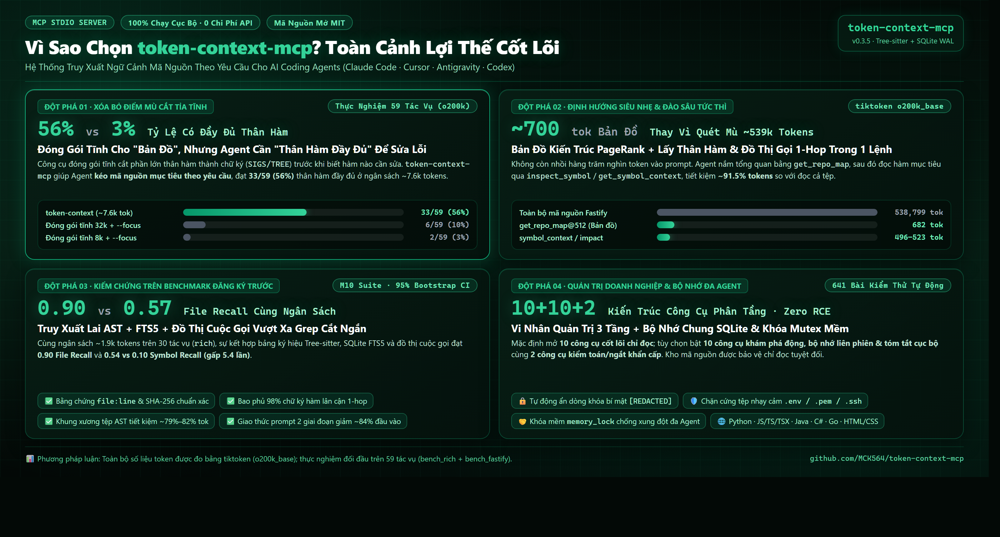
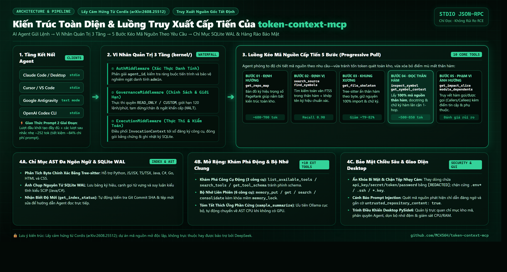
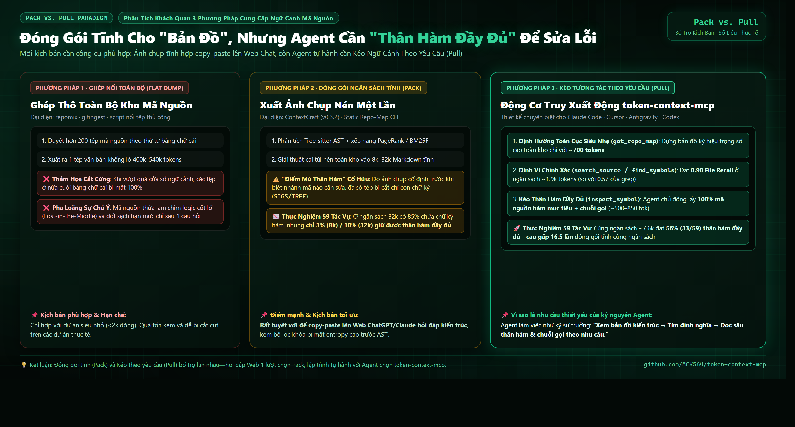
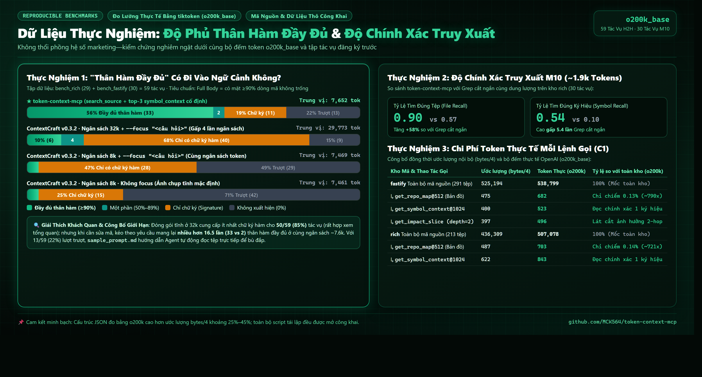
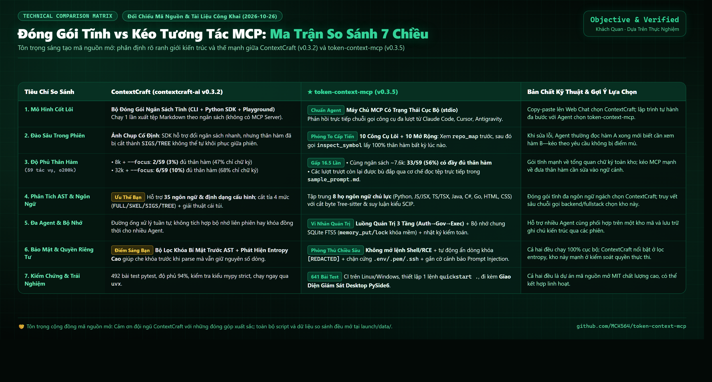

# Token Context MCP (v0.3.5)

[](https://github.com/MCK564/token-context-mcp/actions/workflows/ci.yml)
[](https://pypi.org/project/token-context-mcp/)
[](https://www.python.org/)
[](LICENSE)

> 🌐 English: [`README.md`](README.md) | 🇻🇳 Tiếng Việt: [`README.vi.md`](README.vi.md) | 🇨🇳 简体中文: [`README.cn.md`](README.cn.md) | 📝 Mẫu Prompt: [`sample_prompt.md`](sample_prompt.md) | 📋 Changelog: [`CHANGELOG.md`](CHANGELOG.md) | 🔬 Báo cáo nghiên cứu: [`DEEP_RESEARCH_MCP_AND_HARNESS_REPORT.md`](DEEP_RESEARCH_MCP_AND_HARNESS_REPORT.md)

> [!NOTE]
> **Lưu ý kiến trúc**: Thiết kế vi nhân (governance microkernel) của `token-context-mcp` được lấy cảm hứng từ bài báo Cordis (*A Programming Paradigm for Spatiotemporal Composability*, arXiv:2608.25512). Đây là dự án nguồn mở độc lập, không có quan hệ trực thuộc hay bảo trợ bởi DeepSeek.

`token-context-mcp` là một **Local Model Context Protocol (MCP) Server** bảo mật, siêu nhẹ, chỉ đọc (read-only), được thiết kế để lập chỉ mục mã nguồn bằng Abstract Syntax Tree (Tree-sitter AST) và đồ thị quan hệ từ vựng. Thay vì nhồi toàn bộ kho mã nguồn vào ngữ cảnh (dễ gây quá tải và trôi thông tin), server cho phép các AI Coding Agent (Claude Code, Google Antigravity, Cursor, Codex) **kéo ngữ cảnh tương tác theo nhu cầu (Interactive MCP Pull)** với chi phí token tối ưu và bằng chứng kiểm chứng `file:line` + hash.

---

## 🖼️ Bộ Infographic Kiến trúc & Đo đạc Thực nghiệm (Retina Dark Green)

<p align="center">
  
</p>

<details>
<summary><b>🔍 Xem thêm 4 sơ đồ kiến trúc & đối chiếu chi tiết (Click để mở)</b></summary>

### 1. Vi nhân Quản trị 3 Tầng & Luồng Kéo Ngữ Cảnh 5 Bước
<p align="center">
  
</p>

### 2. Đối Chiếu 3 Mô Hình Cung Cấp Ngữ Cảnh
<p align="center">
  
</p>

### 3. Kiểm Chứng Thực Nghiệm: 59 Tác Vụ Head-to-Head & M10
<p align="center">
  
</p>

### 4. Ma Trận Đối Chiếu Kỹ Thuật Toàn Diện 7 Chiều (So với ContextCraft)
<p align="center">
  
</p>

</details>

---

## ⚡ Điểm nổi bật ở phiên bản v0.3.5

1. **Vi nhân Quản trị 3 Tầng (`kernel/`)**:
   - Toàn bộ luồng thực thi đi qua `InvocationContext` mang danh tính agent và lan truyền ngữ cảnh qua `contextvars`.
   - **Tầng 1 (Response Cap)**: Cắt ngắn tại ranh giới AST cú pháp sạch khi vượt `max_response_tokens`, không cắt cụt giữa hàm.
   - **Tầng 2 (Async Timeout)**: Tự động ngắt timeout trên từng tool (10s cho map, 5s cho search) tránh treo phiên với monorepo lớn.
   - **Tầng 3 (Session Circuit Breaker)**: Theo dõi ngân sách tích lũy cả phiên, cảnh báo ở mức 80% và ngắt cứng tại **150.000 tokens** để chống vòng lặp vô tận.
2. **Không phình to định nghĩa công cụ (Zero Schema Bloat)**:
   - Mặc định danh mục `tools/list` chỉ mở **10 công cụ truy xuất đọc (Core Retrieval)**; 10 công cụ mở rộng (bộ nhớ chia sẻ, tự khám phá tool, tóm tắt) và 2 công cụ quản trị (admin) được giấu kín cho tới khi bật tùy chọn, giúp tiết kiệm tối đa token khởi tạo phiên.
3. **AST Byte-Span Body Elision (`sampling/skeleton_hybrid.py`)**:
   - Cắt tỉa thân hàm chính xác theo tọa độ byte AST của Tree-sitter (`body_start_byte`/`body_end_byte`) cho Python, Java, TypeScript, C#, Go. Giảm **~80% token** so với đọc toàn bộ file nguồn.
4. **Tương thích Reasoning LLM (`sampling/router.py`)**:
   - Tự động bóc tách sạch sẽ các thẻ suy luận nội tâm `<think>...</think>` của các mô hình reasoning (DeepSeek R1, Qwen-QwQ) trước khi parse JSON, ngăn chặn lỗi crash format.

---

## 📊 Kết quả kiểm chứng thực nghiệm (`tiktoken o200k_base`)

Tất cả số liệu dưới đây được đo đạc và tái lập độc lập bằng tokenizer `o200k_base` trên hai repository mã nguồn mở: `rich` (Python, 213 files, 507k tokens) và `fastify` (JS/TS, 291 files, 538k tokens):

| Bộ kiểm thử | Chỉ số đo | token-context-mcp | Bộ đối chiếu | Kết luận thực nghiệm |
| :--- | :--- | :---: | :---: | :--- |
| **59-Task Head-to-Head** (Ngân sách ngang bằng ~7.6k tokens) | Tỷ lệ đưa trọn vẹn thân hàm vào ngữ cảnh (**Full Body** $\ge 90\%$) | **33 / 59 (55.9%)** | 2 / 59 (3.4%) *(ContextCraft 8k `--focus`)* | **16.5×** nhiều thân hàm đầy đủ hơn ở cùng mức chi phí token |
| **59-Task H2H (Độ nhạy)** (So với ngân sách tĩnh gấp 4 lần: 32k tokens) | Tỷ lệ Full Body vs Signature Only | **33 / 59 Full Body** (ở 7.6k) | 6 / 59 Full Body, **40 / 59 (67.8%) Signature Only** *(ContextCraft 32k)* | Đóng gói tĩnh buộc phải cắt hàm xuống mức chữ ký khi nén cả kho; kéo tương tác tập trung 100% ngân sách vào đúng hàm cần sửa |
| **M10 Retrieval** (`rich`, n=30, cùng ngân sách ~1.9k tokens) | Tỷ lệ tìm đúng file (File Recall) & đúng symbol (Symbol Recall) | **0.90** File Recall<br/>**0.54** Symbol Recall | 0.57 File Recall<br/>0.10 Symbol Recall *(Truncated Grep)* | Recall file **+58%**, recall symbol gấp **5.4×** so với grep bị cắt cùng kích thước |
| **C1 Wire Token Cost** (`fastify` 538k tokens source) | Bản đồ định hướng `get_repo_map@512` | **682 tokens** | 538,799 tokens (toàn bộ mã nguồn) | Bản đồ thu nhỏ chiếm **0.13%** kho mã nguồn (~790× nhỏ hơn) |

---

## 🚀 Khởi động nhanh (Quick Start)

### Cách 1: Chạy ngay không cần cài đặt với `uvx` (Khuyên dùng)
```bash
# Đăng ký và lập chỉ mục tự động cho repo hiện tại
uvx token-context-mcp quickstart .
```

### Cách 2: Cài đặt qua `pip`
```bash
pip install token-context-mcp

# Đăng ký repo và chạy server
token-context register --repo-id my-project --root /path/to/project
token-context index --repo-id my-project
token-context serve
```

### Desktop GUI (PySide6)
Giao diện quản lý trực quan với telemetry CPU/RAM, danh sách repo và kiểm soát bảo mật agent:
```bash
uvx --from "token-context-mcp[gui]" token-context-gui
```

---

## 🤖 Cấu hình kết nối cho các Coding Agent

`token-context-mcp` giao tiếp qua luồng `stdio`. Thêm đoạn cấu hình sau vào client của bạn:

### 1. Claude Code
```bash
claude mcp add --transport stdio --scope user token-context -- uvx token-context-mcp serve
```

### 2. Cursor
Trong Cursor Settings > Features > MCP Servers:
- **Name**: `token-context`
- **Type**: `command`
- **Command**: `uvx token-context-mcp serve`

### 3. Claude Desktop
Thêm vào `%APPDATA%\Claude\claude_desktop_config.json` (Windows) hoặc `~/.config/Claude/claude_desktop_config.json` (macOS/Linux):
```json
{
  "mcpServers": {
    "token-context": {
      "command": "uvx",
      "args": ["token-context-mcp", "serve"]
    }
  }
}
```

### 4. Google Antigravity / Gemini CLI
Thêm vào file cấu hình MCP:
```json
{
  "mcpServers": {
    "token-context": {
      "command": "uvx",
      "args": [
        "token-context-mcp",
        "serve",
        "--output-mode", "text",
        "--schema-profile", "gemini_safe"
      ]
    }
  }
}
```

---

## 🛠 Danh mục Công cụ MCP (10 Công cụ Lõi Mặc định)

Mặc định server chỉ kích hoạt **10 công cụ truy xuất đọc (Core Retrieval)** để bảo vệ context window:

| Công cụ | Chức năng chính | Chế độ |
| :--- | :--- | :---: |
| `list_repositories` | Liệt kê danh sách các `repo_id` đã đăng ký (ẩn đường dẫn ổ đĩa nhạy cảm). | Read-only |
| `get_index_status` | Kiểm tra trạng thái index, số file, commit SHA và độ tươi mới. | Read-only |
| `get_repo_map` | Bản đồ định nghĩa toàn repo dựa trên PageRank trong giới hạn token budget (`@512`). | Read-only |
| `find_symbols` | Tìm kiếm symbol theo mẫu wildcard (`*`, `?`) kèm tọa độ dòng code. | Read-only |
| `search_source` | Tìm kiếm toàn văn FTS5 trong mã nguồn, trả về đoạn mã kèm số dòng ngữ cảnh. | Read-only |
| `get_file_skeleton` | Bóc tách khung xương file (import, class, chữ ký hàm, giấu thân hàm). | Read-only |
| `get_symbol_context` | Lấy trọn vẹn thân hàm (full body), docstrings và danh sách callers/callees (`@1024`). | Read-only |
| `get_impact_slice` | Phân tích lát cắt ảnh hưởng downstream trước khi sửa code (`depth=2`). | Read-only |
| `get_module_dependents` | Trích xuất đồ thị quan hệ phụ thuộc import giữa các module. | Read-only |
| `inspect_symbol` | Luồng định vị kết hợp: resolve symbol + lấy ngữ cảnh + đồ thị ảnh hưởng 1-hop. | Read-only |

*(10 công cụ mở rộng bao gồm bộ nhớ SQLite multi-agent `memory_*`, công cụ tự khám phá `*_tools`, bộ nén `sample_summarize` và 2 công cụ quản trị `agent_control`, `audit_logs` có thể bật qua cấu hình).*

---

## 🔒 Cam kết Bảo mật & Ranh giới Hệ thống

- **Không thực thi mã (No Arbitrary Execution)**: Server không chứa bất kỳ endpoint nào chạy shell, bash hay eval lệnh hệ thống.
- **Bảo mật mã nguồn cục bộ (100% Local)**: Toàn bộ chỉ mục SQLite WAL nằm trên máy cá nhân, không gửi dữ liệu ra bên ngoài.
- **Tự động lọc thông tin nhạy cảm (Secret Redaction)**: Tự động phát hiện và che giấu các chuỗi khóa API, password, token bí mật (`[REDACTED: potential secret]`) và chặn truy cập các file nhạy cảm (`.env*`, `.ssh`, `*.pem`, `id_rsa`).

---

## 📚 Tài liệu liên quan

- [`sample_prompt.md`](sample_prompt.md): Mẫu prompt chuẩn định vị 2 giai đoạn cho AI Agent (EN / VI / CN).
- [`CHANGELOG.md`](CHANGELOG.md): Nhật ký phiên bản chi tiết.
- [`launch/00_fact_sheet.md`](launch/00_fact_sheet.md): Bảng số liệu thực nghiệm đã được kiểm chứng bằng `o200k_base`.
- [`docs/CLIENT_MATRIX.md`](docs/CLIENT_MATRIX.md): Hướng dẫn kiểm tra tương thích giữa các MCP client.

---
*Phát triển bởi cộng đồng Token Context MCP. Giấy phép mã nguồn mở MIT.*
